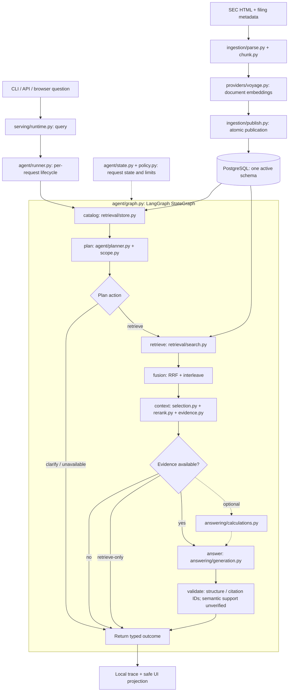

# Financial Report RAG

[English](README.md) · [简体中文](README.zh-CN.md)

## Overview

A SEC annual-report research application built with Python, LangGraph, PostgreSQL/pgvector, Voyage embeddings and DeepSeek. It answers company and financial-period questions with source citations and lets users inspect how each answer was produced. The current published corpus contains **5 companies, 16 filings and 4,961 chunks**; source manifests are versioned, while the database and original filings are prepared separately.

- Parse SEC HTML and tables into source-linked blocks and chunks; publish documents atomically.
- Turn a question into a validated company/period plan, retrieve and rerank evidence, then generate a cited answer. Missing periods are disclosed or clarified when material.
- Inspect node state changes, timings, nested calls, evidence and source-code locations in the local workflow explorer.
- Apply shared request/cumulative budgets, bounded attempts, a cooperative deadline and cancellation.

Answers use the published corpus; the agent does not browse the Web autonomously. Forecasting, valuation, autonomous evidence-retry loops and persistent conversation memory are not implemented.

## Evaluation results

### Latest end-to-end baseline: 41 cases

**Run: 2026-11-11; offline review: 2026-11-12. Provisional development results, pending human calibration.** All 41 cases were attempted; 38 produced answers and three failed at planner validation. These are canonical intents derived from **20 parent question families**, not 41 independent user queries or a held-out test. The 12 previously accepted pilot references were retained; the other 29 were agent-audited against source filings.

The set has 37 positive-evidence and four disclosure-only cases, 166 required evidence groups, 80 required facts and 75 distinct numeric checks applied 84 times. This evaluates the saved baseline snapshot. Later demo, budget and temporal-planner changes have **not** been rerun on the full set. Historical retrieval experiments below use different questions/labels and do not establish a score improvement.

| End-to-end measure | Result | Definition / denominator |
| --- | ---: | --- |
| Answer delivery | **38/41 (92.68%)** | Three planner failures remain in the attempted denominator |
| Strict task pass | **26/41 (63.41%)** | Required facts, numbers, boundaries and behavior pass with no material error; 12 reviewed failures + 3 execution failures |
| Required-fact completeness | **66/80 (82.50%)** | Correct = 1, partial = 0.5, missing/undelivered = 0 |
| Required numeric delivery and correctness | **70/84 (83.33%)** | 25 exact + 45 acceptable rounding; 6 omitted + 8 undelivered |
| Full citation support, asserted required facts | **61/65 (93.85%)** | Four partially supported; conditional on facts actually stated |
| Required citation delivery coverage | **61/73 (83.56%)** | Includes omissions/failures; seven analytical boundary facts are N/A; literal all-fact coverage is 61/80 (76.25%) |
| Material-error cases | **5/41** | Includes errors outside the predefined numeric checklist |
| Technical failure rate | **3/41 (7.32%)** | Planner scope-validation failures, not missing disclosures |

The 70/70 correct **mapped** required numeric checks are a conditional result, not 100% correctness of every number in the answers. The review separately caught an unchecked tenfold unit error.

| Whole-answer rubric (1–5) | Generated answers (n=38) | Delivery-adjusted (n=41) |
| --- | ---: | ---: |
| Completeness | 4.45 | 4.12 |
| Truthfulness | 4.32 | 4.00 |
| Faithfulness to supplied evidence | 4.32 | 4.00 |
| Relevance | 3.45 | 3.20 |
| Clarity | 3.34 | 3.10 |

Undelivered answers have N/A on the original rubric; the adjusted columns divide score sums by all 41 attempts, assigning zero delivery credit. The five dimensions are not averaged into an “accuracy” percentage.

| Evidence coverage diagnostic | Recorded positive-evidence cases (n=34) | Confirmed-coverage lower bound, all positive cases (n=37) |
| --- | ---: | ---: |
| Candidate pool | 93.15% | 85.60% |
| Coarse Top80 | 87.97% | 80.84% |
| Actual generation context | 78.55% | 72.18% |

Coverage is macro recall of required evidence groups, matched against actual source spans. The all-positive column gives zero confirmed coverage to the three pre-retrieval failures; four disclosure-only cases have N/A positive-evidence recall. Precision@k, MRR, nDCG and RAGAS Context Precision/Recall were **not measured**.

**Conditions and cost.** Real serial runs through the shared LangGraph runtime; DeepSeek Flash for planning/reranking/generation, Voyage 4-lite (1024D), HNSW dense Top20/job, RRF/interleaving, Top80 LLM reranking, 8K evidence / 24K input proxy-token caps. Hybrid, dedicated CrossEncoder, regrouping and deterministic calculations were disabled. Cost was **$0.91794642 total** (about $0.0224/attempt), under the approved $1.10 cap; 232 provider attempts, 194 logical LLM calls and 512 SQL attempts. Planner/rerank caches had zero hits; document vectors were reused. Request median was **25.13s**, empirical p95 **32.88s** in this serial sample, not a concurrency/load SLO. Costs are conservative list-price estimates, not invoices.

**Review method.** Read saved answers and the evidence actually delivered to the generator; fill the fixed five-dimension rubric and item verdicts in conversation; validate hashes, source quotations, attached citations, dates and Decimal numeric checks; aggregate offline. No paid Judge or RAGAS scoring ran. This is assisted review, not independent blind judging; semantic verdicts still require human calibration. [Rubric](specs/009-answer-evaluation/contracts/whole_answer_rubric.json) · [Evaluation methods](docs/evaluation.md) · [41-case references and data](data/evaluation/baseline41/README.md) · [Public summary, case scores and provenance hashes](reports/public/baseline41.json).

**What failed.** U06.02/.03/.06 stopped on planner scope validation. Material errors involved false missing-input claims (U02.04), business/segment comparability (U11.01/.03), quarterly versus annual operands (U15.07), and billion-to-亿 unit conversion (U19.02). U04.02 also lacked revenue inputs in the actual context. Lower stage recall is diagnostic; it does not by itself identify the cause of an answer error.

[Stage-by-stage analysis: what each change contributed, why it helped, regressions and missing ablations](docs/experiments.md#stage-contributions).

### Earlier retrieval experiments

The early five-chunk/28-combination study reached **86% frozen-test Recall@10**, but recovered all required evidence for only **1/5** cross-document questions. Later 20-question development comparisons used 225 evidence groups and identical per-question context budgets:

| 20-question retrieval comparison | Candidate recall | Top80 recall | Final-context recall | All evidence recovered |
| --- | ---: | ---: | ---: | ---: |
| Dense + LLM rerank | 94.47% | 80.95% | 67.66% | 4/20 |
| Dense + BM25 query replacement + LLM | 94.77% | 83.87% | 71.53% | 5/20 |
| Evidence-objective regrouping + LLM | 95.62% | 79.19% | 67.62% | 5/20 |
| Dense + dedicated CrossEncoder | 94.47% | 80.95% | 59.20% | 4/20 |

These are evidence-recall comparisons, **not answer-quality scores or concurrent A/B tests**. Each used 342 SQL searches, exact vector search, Top20/job, a Top80 reranking window, saved plans and some reused grades. Dense + LLM remains the default; the BM25 gain alone was not treated as generalization evidence. Full-pool reranking reached 71.45% with higher cost; a separate focused-query experiment reached 69.81%. Other arithmetic/answer follow-ups, regressions and ANN conditions are in [the experiment guide](docs/experiments.md) and [public experiment evidence](reports/public/experiments/README.md).

## How requests and documents flow



`serving.cli/api → serving.runtime.query → agent.runner → agent.graph → nodes → retrieval/answering`. Ingestion publishes into PostgreSQL separately. Nodes are workflow steps, not subagents. `evaluation/` now contains only current dataset/run/scoring utilities; retired `experiments/` and archive dependencies were removed.

| Package | Important files |
| --- | --- |
| `agent` | `runner.py`: lifecycle; `graph.py`: edges; `nodes.py`: adapters; `state.py`: state; `policy.py`: limits; `planner.py`/`scope.py`: intent and filters |
| `ingestion` | `acquire.py`, `parse.py`, `chunk.py`, `publish.py`, `generalization.py`: source → published chunks |
| `retrieval` | `store.py`: SQL/ANN; `search.py`: jobs/RRF; `selection.py`: rerank/context; `rerank.py`: grades; `evidence.py`/`context.py`: source selection |
| `answering` | `generation.py`: cited answers and structure checks; `calculations.py`: disabled arithmetic experiment |
| `providers` / `core` | Paid API adapters, caches and one ledger / shared data models, settings, files and trace |
| `serving` | CLI/API, resource wiring, safe trace projection, code registry and static UI |
| `evaluation` | `__main__.py`: CLI; `run.py`: real requests; `answers.py`/`rubric.py`: answer scoring; `evidence.py`: span recall; `dataset.py`: accepted-data validation; `benchmark.py`: offline trace diagnosis/comparison |

Default: HNSW dense Top20/search → RRF/interleave → ≤512 candidates → Top80 LLM reranking → 8K evidence / 24K input. BM25, CrossEncoder and arithmetic remain optional. The graph is bounded; evidence re-querying, persistent checkpoints and multi-agent operation are not enabled. Evidence availability is not semantic correctness.

## Repository and source layout

```text
financial-report-rag/
├── src/finrag/       # Installable Python package / import finrag
│   ├── agent/       # LangGraph state, nodes, routing, planner and limits
│   ├── ingestion/   # Download, parse, chunk and publish atomically
│   ├── retrieval/   # SQL/ANN, fusion, reranking and context
│   ├── answering/   # Answers, citation checks and optional arithmetic
│   ├── providers/   # DeepSeek/Voyage, caches and shared billing
│   ├── core/        # Models, configuration, files and traces
│   ├── serving/     # CLI, API/SSE and Trace Studio UI
│   └── evaluation/  # Data checks, batch runs and offline scoring
├── configs/         # Active service, issuer and chunk settings
├── data/            # Sources, parsed data, caches and evaluation data
├── scripts/         # Six operational and dataset scripts
├── tests/           # Regression tests for current behavior
├── docs/            # Architecture, workflows, choices and findings
├── specs/           # Versioned requirements and plans
├── reports/         # Local reviews and public result summaries
└── logs/            # Local request traces; excluded from Git
```

`src/` is the source container; `finrag/` is the installable Python package. Keeping the package layer makes imports and installation explicit and keeps tests/data/scripts outside application code. `docs/` explains implementation; `specs/` records requirements and decisions by development increment. Their numbers do not represent parallel runtimes.

Use an activated Python 3.12 environment; its directory name does not affect runtime behavior. Credentials, environments, raw sources, caches and logs are excluded from Git. [Complete file responsibilities](docs/repository-layout.md). [Nodes, edges and runtime call chain](docs/repository-layout.md#langgraph节点边与模块怎么串起来).

## Setup and local demo

Python 3.12, PostgreSQL with pgvector, and DeepSeek/Voyage credentials are required for live queries. A fresh checkout does not include a populated database, raw filings, credentials or private run history. Follow [data and ingestion](docs/data-and-ingestion.md) to prepare the corpus; examples below run from the repository root.

```bash
python3.12 -m venv .venv
source .venv/bin/activate
python -m pip install -r requirements.lock
cp .env.example .env
# Configure PostgreSQL, Voyage, DeepSeek and SEC User-Agent in the ignored .env.
# Prepare/publish the corpus using docs/data-and-ingestion.md.
python -m finrag.serving.cli serve --port 8000
```

Open **http://127.0.0.1:8000/**. No npm server/build is needed. Enter a question to see node state changes, timings, internal calls, code and citations. Analysis years belong in the question; **Advanced options → Information cutoff** defaults to today and only limits public disclosures. If no period is supplied, the plan states in-corpus coverage when reasonable or asks a material clarification. State exposes the scope and its basis.

Live requests may incur planning, embedding, LLM reranking, generation and bounded repair costs. The request cap is $0.15, including $0.04 answer headroom, with an additional configured cumulative stop, attempts/deadline and cancellation controls. Opening the UI, reading code or replaying available saved records makes no paid call. Historical traces missing state snapshots remain explicitly incomplete. [UI/module guide](docs/trace-explorer.md) · [Execution controls](docs/rag-agent-refactor.md#6-orchestrator与执行策略).

```bash
# In the activated environment:
python -m finrag.serving.cli query "比较 NVDA 和 AMD 的 FY2025 数据中心业务" --as-of 2026-11-08
```

## Every runtime and evaluation entry

The commands below use the activated environment. Query/run may spend API credit; dataset checks, packet preparation, judge-prompt export and scoring are offline. Argument names match the code.

| Entry | Input → output / purpose | Cost or writes |
| --- | --- | --- |
| `python -m finrag.serving.cli --help` | List runtime commands/options | None |
| `python -m finrag.serving.cli serve --port 8000` | Start browser UI/API/SSE/code viewer | No model call on startup |
| `python -m finrag.serving.cli query "question" --as-of 2026-11-08` | User request → cited answer + `logs/serving/` trace | Uncached APIs may cost money |
| Same query with `--retrieve-only` | Planner, retrieval, rerank and context; skip answer | Still potentially paid; not pure retrieval |
| `python -m finrag.serving.cli init` | Initialize selected service schema | Writes DB |
| `python -m finrag.serving.cli download` | Pinned `data/sources.jsonl` → local HTML | SEC network only |
| `python -m finrag.serving.cli ingest --html FILE --metadata META.json` | Trusted HTML/metadata → atomic publication | DB writes; new embeddings may be paid |
| `python -m finrag.serving.cli ann --kind hnsw` | Build selected ANN index; IVF also supported | DB/resources |
| `python -m finrag.serving.cli aliases --metadata configs/serving_company_aliases.json` | Register trusted issuer aliases | DB metadata only |
| `python -m finrag.ingestion.generalization download` | Download expansion manifest | SEC network only |
| Same module `prepare` / `publish` | Audit and estimate / explicitly publish | Prepare is offline; publish may be paid |
| `python -m finrag.evaluation --help` | List every evaluation command | None |
| `python -m finrag.evaluation check-data` | Verify compound release and intent draft | Offline/read-only |
| `python -m finrag.evaluation check-data --dataset compound` or `intents` | Verify one dataset | Offline/read-only |
| `python -m finrag.evaluation validate-set --dataset data/evaluation/pilot` | Verify accepted 33-case data and hashes | No DB/API |
| `python -m finrag.evaluation diagnose --help` / `compare --help` | Saved traces/imported reviews → stage/behavior/answer report and paired changes | Offline; absent traces/judgments do not pass |
| `python -m finrag.evaluation build-intents` | Parent references + split specs → 81-intent draft | Offline; writes draft only |
| `python -m finrag.evaluation run --ids U11 --out reports/current/new-run` | Query-only cases → current engine responses/traces | May spend APIs; existing ledger stop applies |
| `python -m finrag.evaluation prepare-judge --help` | Saved traces + gold → judge packets | Offline |
| `python -m finrag.evaluation export-judge --help` | Packets + rubric → reusable prompt JSON | Offline; does not call a judge |
| `python -m finrag.evaluation score --help` | Imported verdicts → scores/review | Offline |
| `python -m pytest -q` | Current regression suite | No paid API; DB tests opt-in |
| `FINRAG_INTEGRATION=1 python -m pytest tests/test_serving_database.py -q` | Disposable DB ingestion/ANN/graph checks | Temporary DB writes, no paid models |

`fr-rag-serve` and `fr-rag` alias the runtime module. [Ingestion metadata shape](docs/data-and-ingestion.md).

## Every retained script

| Script | Why it remains | Invocation / inputs and outputs |
| --- | --- | --- |
| `scripts/ingest_manifest.py` | Publish every filing in a trusted manifest | `python scripts/ingest_manifest.py --manifest data/sources.jsonl --companies configs/companies.json` inspects only; add `--publish` for DB publication and possibly paid embeddings |
| `scripts/inspect_database.sql` | Inspect filings/chunks/spans/vector dimensions/indexes | Open in pgAdmin Query Tool; read-only |
| `scripts/build_golden_v2.py` | Frozen reviewed 20-question recipe and validator; its established path is part of provenance | Prefer `python -m finrag.evaluation check-data --dataset compound`; direct `python scripts/build_golden_v2.py --check` is equivalent. Uses raw/processed sources and released authoring inputs |
| `scripts/build_golden_v3.py` | Construct the 81-intent development draft from those 20 questions | Prefer `python -m finrag.evaluation build-intents`; direct execution rebuilds, `--check` verifies. Reads parent specs + `split_specs.json`, writes draft artifacts |
| `scripts/check_publication.py` | Scan actual staged Git bytes for secrets/private paths/oversized artifacts | `python scripts/check_publication.py`; no staging, commit or push |
| `scripts/verify_public_evidence.py` | Recompute public historical metric arithmetic and check documentation links | `python scripts/verify_public_evidence.py`; no DB, raw large traces or model |

## Datasets and prompts

`golden_v2` is the reviewed **20-compound-question release**. `golden_v3` is the **81-intent derived draft**, pending review. These are annotation versions, not retrieval algorithms or fiscal years; neither is an independent production holdout. The two builders are actively needed for release verification and draft reconstruction. Their established filenames are retained for provenance; use `evaluation check-data/build-intents` for daily operation.

Within each dataset, `retrieval_queries.jsonl` is query-only input; `golden.jsonl`, `rubrics.jsonl`, `numeric_checks.jsonl` and reference answers are judge-only labels. Parent answer/label specs feed intent reconstruction. Small frozen v1 files, `configs/best.json`, `reports/test_release.json` and the two `review_v2` records are still read or hash-checked by the released builder; they do not control live search. Other authoring drafts were removed. [Dataset details](data/evaluation/README.md).

The top-level historical `prompts/` folder was deleted. Active prompts live next to the code that runs them: `agent/planner.py:PLANNER_PROMPT`, `retrieval/rerank.py:RERANK_PROMPT`, `answering/generation.py:ANSWER_PROMPT`; offline judge inputs are built by `evaluation/rubric.py:judge_inputs`. The five-dimension rubric is in `specs/009-answer-evaluation/contracts/whole_answer_rubric.json`. Never give reference answers/qrels to the live planner.

`reports/current/` retains compact existing answers/evidence/verdicts for local review. `reports/public/` contains sanitized summaries. Old driver code, synthetic benchmark programs and the whole archive were removed; historical scores remain descriptions of their original conditions, not currently replayable raw runs. Runtime, dataset validation and scoring need no archive.

For exact packet/export/score examples, see the [bilingual workflow](README.zh-CN.md#用已保存回答生成审核材料); each subcommand also supports `--help`.

## Validation and next steps

```bash
python -m pip install -r requirements-evaluation.lock
python -m pytest -q
python scripts/verify_public_evidence.py
ruff check src tests
# Requires prepared local source data:
python -m finrag.evaluation check-data
# Explicit disposable DB fixtures; no paid model calls:
FINRAG_INTEGRATION=1 python -m pytest tests/test_serving_database.py -q
```

The [33-case pilot](data/evaluation/pilot/README.md) includes canonical/raw-mock pairs, boundaries and clarification continuations. These provide development regressions, not a measured natural-query or independent holdout score. Next priorities are planner report-versus-fact-period handling, numeric units/actual periods, unsupported missing-data claims, and Top80/context losses under fixed budgets. Preserve passing controls and compare final-answer rubric scores after any separately authorized real run. The temporal-scope/UI changes have offline coverage; they have no new 41-case quality score.

[Architecture](docs/architecture.md) · [Ingestion](docs/data-and-ingestion.md) · [Evaluation methods](docs/evaluation.md) · [Workflow explorer](docs/trace-explorer.md)

## Development/generated directories

`.github/` contains CI; `.specify/` and `.agents/skills/` support Spec Kit development and are not runtime tools. `specs/` records requirements/acceptance (009: evaluation, 010: dataset, 012: agent, 014: explorer, 015: temporal scope). Virtual environment directories (for example `.venv/`) are local and ignored; their names do not affect package imports. `.pytest_cache/`, `.ruff_cache/`, `__pycache__/` and `src/*.egg-info/` are generated test/lint/bytecode/package metadata, not handwritten components. `.git/` is history; `.gitignore` excludes private/generated files. `.env` stores local secrets and `.env.example` is the public template. `pyproject.toml` defines packaging/entrypoints; the two lock files separate runtime and full evaluation dependencies. Development conventions and data licensing are described below. AGENTS.md is ignored local developer guidance.

`__init__.py` marks a package; `evaluation/__main__.py` implements the module command. Other application files are called by graph nodes/services rather than executed individually.

## Development and contributions

Start with [development](docs/development.md) and the relevant feature in `specs/`. Keep runtime inputs separate from evaluation labels, retain source and period metadata, and add regression checks when behavior changes. Preserve frozen labels and experiment controls.

Run the tests and `python scripts/check_publication.py` after staging changes. Database checks are opt-in; paid API runs require an explicit budget. Keep credentials, caches and full local responses out of commits. For retrieval changes, report the data split, fixed budgets, candidate/Top80/context recall and regressions. For generation, assess answer completeness, numerical correctness and citation support separately from output-format checks.

## Data and licensing

Filings come from SEC EDGAR; source manifests retain filing URLs and checksums. Company disclosures and third-party statements are not original research by this project. The PageIndex helper was removed with the retired tree-retrieval experiments; historical versions retain its upstream provenance and license notices.

No project-wide license has been selected. Public visibility alone does not grant a license to all repository material; third-party components retain their own terms.
