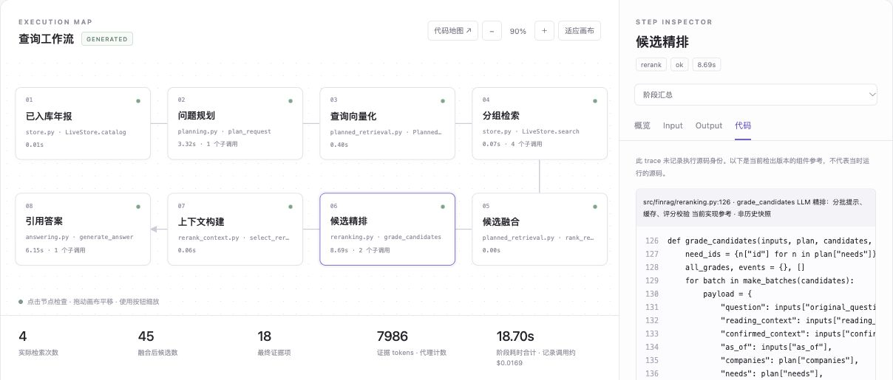
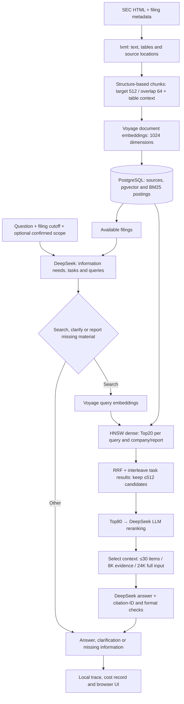

# Financial Report RAG

[English](README.md) · [简体中文](README.zh-CN.md) · [Experiments](docs/experiments.md)

Search SEC annual reports, compare companies and years, and inspect the sources behind each answer.

The local app covers **5 companies, 16 filings and 4,961 chunks**. It parses HTML text and tables, plans searches, retrieves and reranks passages, and generates answers with citations. The trace viewer shows each step's input, output, model/SQL calls and code.



Screenshot from a saved run. [Read a completed query and a failed run](docs/examples.md) without setting up an API.

## The problem

“What drove NVIDIA and AMD's growth over three years, and did operating cash flow keep up with revenue?” The answer may need several filings, tables and footnotes. It also needs the right companies, periods and accounting definitions.

This project makes those retrieval steps visible so missing evidence can be traced to a search, ranking or context-selection decision. RAG limits how much text reaches the answer model and lets the application filter by company and filing date. For a few reports, sending full documents is also a useful baseline; that comparison has not been measured here.

## How it works



**Default:** HNSW dense search → RRF/merged task results → DeepSeek LLM reranking → cited answer. BM25 retrieval, task regrouping and Voyage `rerank-3-lite` are optional experiments. Token limits use a local tokenizer estimate, not provider billing counts.

[`serving/runtime.py:execute`](src/finrag/serving/runtime.py) connects the query stages. Ingestion runs through a separate CLI: it keeps source locations/table structure, skips unchanged documents before embedding, and commits each document in one transaction. Queries see only fully published documents.

[Parameters and database tables](docs/architecture.md) · [Stage-to-file code map](docs/development.md#follow-the-current-query-in-code)

## Design choices

| Choice | Reason and tradeoff |
| --- | --- |
| SEC HTML | Preserves tables and source locations without OCR. PDFs and images are not supported yet. |
| PostgreSQL + pgvector | Stores source text, metadata, vectors and keyword indexes together. FAISS alone would still need a separate document/metadata store. |
| Structure-based chunks | Keeps table titles and units near rows. Selected using the v1 development set; long rows can exceed the target size. |
| LLM planning and reranking | Handles compound questions and grades passages against their information needs. Adds model cost and latency. Valid JSON can still contain wrong decisions. |
| Python workflow | The call sequence, limits and errors are explicit. LangGraph/DeepAgents are not needed for the current fixed workflow. |

Dense search handles different wording; keyword search can help with exact terms. RRF combines result rankings. Company names and aliases come from metadata, so adding a company does not require editing an issuer list in Python.

## What the tests showed

The early v1 study compared five chunk configurations and 28 retrieval combinations. Frozen-test Recall@10 was **86%**, but only **1 of 5** cross-document questions recovered every required evidence group.

The later development set has **20 reviewed questions, 225 required evidence groups and 123 reference-answer numeric checks**. Each group identifies a required fact or passage and may allow alternative sources. Macro recall averages the coverage of each question. Reference answers and labels are used only for offline scoring.

Tracing found most evidence loss after retrieval: candidate coverage was **94.47%**, Top80 coverage **80.95%**, and the context sent to generation **47.34%** before reranking. This led to tests of ranking and context selection under fixed per-question context budgets.

| 20-question development comparison | Candidate recall | Top80 recall | Final-context recall | Complete questions |
| --- | ---: | ---: | ---: | ---: |
| Dense + LLM rerank | 94.47% | 80.95% | 67.66% | 4/20 |
| Dense + BM25 replacement + LLM | 94.77% | 83.87% | 71.53% | 5/20 |
| Regroup tasks by evidence objective + LLM | 95.62% | 79.19% | 67.62% | 5/20 |
| Dense + dedicated CrossEncoder | 94.47% | 80.95% | 59.20% | 4/20 |

These are **evidence-recall scores, not answer accuracy**. Each arm used 342 SQL searches, Top20/search, a Top80 reranking window and matching context budgets. Retrieval used exact search for the comparison, with saved plans and some reused LLM grades; this was not a cold end-to-end service benchmark. BM25 gained 3.87 percentage points, but the default remains dense + LLM pending independent testing.

Other tests showed why the average is insufficient: full-pool reranking reached 71.45% at higher reranking cost; model-selected table rows scored higher but omitted important U12 accounting rows. Focused queries reached 69.81% in a separate experiment. Detailed conditions, costs, regressions and ANN results are in the [experiment guide](docs/experiments.md) and [per-question JSON results](reports/public/experiments/README.md).

## Run locally

Requires Python 3.12, PostgreSQL and pgvector 0.8+. No frontend build is needed.

```bash
git clone https://github.com/RqingLiu/financial-report-rag.git
cd financial-report-rag
python3 -m venv .venv
source .venv/bin/activate
python -m pip install -r requirements.lock
cp .env.example .env
```

Set `DATABASE_URL`, `VOYAGE_API_KEY`, `DEEPSEEK_API_KEY` and your SEC User-Agent in `.env`. Create `financial_report_rag`, then follow the [ingestion instructions](docs/data-and-ingestion.md). The repository includes source manifests and evaluation labels; raw filings, a populated database, API keys and model caches must be prepared locally. Uncached model calls cost money; saved-run replay does not call models.

```bash
fr-rag-serve serve --port 8000
# Open http://127.0.0.1:8000/
fr-rag-serve query "Compare Google FY2024 and Amazon FY2025 cloud revenue disclosures" --as-of 2026-10-28
```

FastAPI serves queries, live trace events, saved runs, the report catalog, code references and `/docs`. It listens on localhost and has no public authentication setup. [UI and API details](docs/trace-explorer.md).

## Limits and next steps

- **Data:** NVIDIA/Micron FY2024–2026; AMD FY2023–2025 plus an amendment; Alphabet/Amazon FY2023–2025. Report year, a table's fact period and filing date are separate fields. `as_of` restricts when a filing was available. [Source manifests](data/sources.jsonl) · [Additional companies](data/generalization/sources.jsonl).
- **Answers:** Citation IDs and output format are checked; numeric accuracy and whether citations support each claim still need evaluation. Stored table grids are not a normalized financial fact store. Calculators, forecasting, valuation and autonomous agent loops are not implemented.
- **Failures and cost:** Invalid plans get at most one repair; ambiguity and missing material return explicit states. Calls reserve cost before execution; unknown charges stay reserved rather than triggering blind retries. Admission limits and per-call timeouts exist, but production concurrency and end-to-end latency are not validated. [Implementation details](docs/architecture.md).
- **Scale:** Real-corpus ANN checks and synthetic 10k/30k/100k-vector tests are reported separately. Synthetic SQL latency does not establish service throughput or financial-evidence recall. [ANN experiments](docs/experiments.md#ann与规模条件).

Next: build an independent test set with new Alphabet/Amazon question intents, evaluate numbers/citations/missing-evidence answers, then test real-corpus growth and concurrent load. Keep paraphrases of the same intent in one split. Financial facts and deterministic calculations will start with a small comparison before adding forecasts. [Evaluation plan and metric definitions](docs/evaluation.md).

```bash
pytest -q
ruff check src tests --exclude src/finrag/vendor
python scripts/verify_public_evidence.py
# Requires local corpus + PostgreSQL; no paid models:
FINRAG_INTEGRATION=1 pytest -q
python scripts/build_golden_v2.py --check
```

[Release validation](reports/public/project_guide_validation.json) · [Historical results](reports/public/README.md) · [Development guide](docs/development.md) · [History](docs/history.md) · [Contributing](CONTRIBUTING.md) · [Data notices](NOTICE.md)
