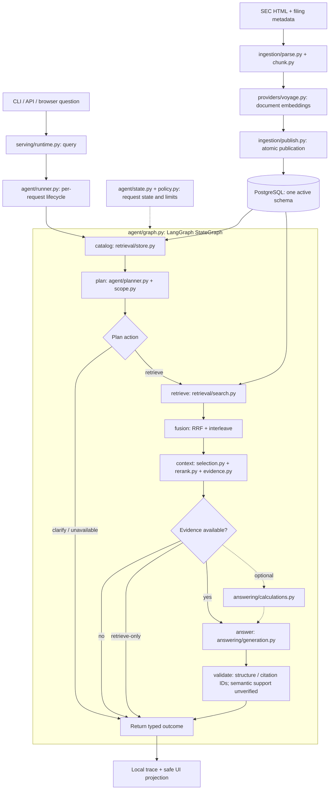

# Financial Report RAG

## Open the local workflow explorer

```bash
# From this repository root; no npm/build step
.venv-migrate/bin/python -m finrag.serving.cli serve --port 8000
```

Open **http://127.0.0.1:8000/**. Select a saved run/case to inspect the actual graph, node timing, available state, child calls, code and answer without API charges. New live queries use paid APIs and existing budgets; startup/replay never spend credit. Old records without state snapshots are labeled rather than reconstructed. [UI guide and every frontend module](docs/trace-explorer.md).


[English](README.md) · [简体中文](README.zh-CN.md)

Retrieve evidence from SEC annual reports, compare companies/years, and inspect each answer's query plan, search results, context and code. The local corpus contains **5 companies, 16 filings and 4,961 chunks**.

**Source boundary:** answers and any future follow-up search use only published database material. No autonomous Web search. Answer supported portions and identify missing information. Downloading new SEC filings is a separately invoked ingestion operation.


Request controls now share node/model/provider/search limits, a 180s cooperative deadline, cancellation and one persistent budget ledger. Failed generation can expose selected evidence without presenting an answer. Defaults are $0.15/request plus $0.04 reserved answer headroom within that cap; the existing cumulative spending stop is unchanged. [Behavior, code locations and offline fault tests](docs/rag-agent-refactor.md#6-orchestrator与执行策略).

## Repository and source layout

```text
financial-report-rag/
├── src/finrag/       # Installable Python package / import finrag
│   ├── agent/       # LangGraph state, nodes, routing, planner and limits
│   ├── ingestion/   # Download, parse, chunk and publish atomically
│   ├── retrieval/   # SQL/ANN, fusion, reranking and context
│   ├── answering/   # Answers, citation checks and optional arithmetic
│   ├── providers/   # DeepSeek/Voyage, caches and shared billing
│   ├── core/        # Models, configuration, files and traces
│   ├── serving/     # CLI, API/SSE and Trace Studio UI
│   └── evaluation/  # Data checks, batch runs and offline scoring
├── configs/         # Active service, issuer and chunk settings
├── data/            # Sources, parsed data, caches and evaluation data
├── scripts/         # Six operational and dataset scripts
├── tests/           # Regression tests for current behavior
├── docs/            # Architecture, workflows, choices and findings
├── specs/           # Versioned requirements and plans
├── reports/         # Local reviews and public result summaries
└── logs/            # Local request traces; excluded from Git
```

`src/` is the source container; `finrag/` is the installable Python package. Keeping the package layer makes imports and installation explicit and keeps tests/data/scripts outside application code. `docs/` explains implementation; `specs/` records requirements and decisions by development increment. Their numbers do not represent parallel runtimes.

The verified local environment is `.venv-migrate`; the original `.venv` was retained. Credentials, environments, raw sources, caches and logs are excluded from Git. [Complete file responsibilities](docs/repository-layout.md). [Nodes, edges and runtime call chain](docs/repository-layout.md#langgraph节点边与模块怎么串起来).

## How requests and documents flow



`serving.cli/api → serving.runtime.query → agent.runner → agent.graph → nodes → retrieval/answering`. Ingestion publishes into PostgreSQL separately. Nodes are workflow steps, not subagents. `evaluation/` now contains only current dataset/run/scoring utilities; retired `experiments/` and archive dependencies were removed.

| Package | Important files |
| --- | --- |
| `agent` | `runner.py`: lifecycle; `graph.py`: edges; `nodes.py`: adapters; `state.py`: state; `policy.py`: limits; `planner.py`/`scope.py`: intent and filters |
| `ingestion` | `acquire.py`, `parse.py`, `chunk.py`, `publish.py`, `generalization.py`: source → published chunks |
| `retrieval` | `store.py`: SQL/ANN; `search.py`: jobs/RRF; `selection.py`: rerank/context; `rerank.py`: grades; `evidence.py`/`context.py`: source selection |
| `answering` | `generation.py`: cited answers and structure checks; `calculations.py`: disabled arithmetic experiment |
| `providers` / `core` | Paid API adapters, caches and one ledger / shared data models, settings, files and trace |
| `serving` | CLI/API, resource wiring, safe trace projection, code registry and static UI |
| `evaluation` | `__main__.py`: CLI; `run.py`: real requests; `answers.py`/`rubric.py`: answer scoring; `evidence.py`: span recall; `dataset.py`: accepted-data validation; `benchmark.py`: offline trace diagnosis/comparison |

Default: HNSW dense Top20/search → RRF/interleave → ≤512 candidates → Top80 LLM reranking → 8K evidence / 24K input. BM25, CrossEncoder and arithmetic remain optional. The graph is bounded; evidence re-querying, persistent checkpoints and multi-agent operation are not enabled. Evidence availability is not semantic correctness.

## Start and query

```bash
# Run at the repository root. Verified local environment:
source .venv-migrate/bin/activate

# Fresh install: Python 3.12; choose runtime or full evaluation dependencies
# python3 -m venv .venv-migrate
# python -m pip install -r requirements.lock
# python -m pip install -r requirements-evaluation.lock
# cp .env.example .env   # Configure DB, Voyage, DeepSeek and SEC User-Agent

python -m finrag.serving.cli serve --port 8000
# Open http://127.0.0.1:8000/
python -m finrag.serving.cli query "比较 NVDA 和 AMD 的 FY2025 数据中心业务" --as-of 2026-11-08
```

## Every runtime and evaluation entry

The commands below use the activated environment. Query/run may spend API credit; dataset checks, packet preparation, judge-prompt export and scoring are offline. Argument names match the code.

| Entry | Input → output / purpose | Cost or writes |
| --- | --- | --- |
| `python -m finrag.serving.cli --help` | List runtime commands/options | None |
| `python -m finrag.serving.cli serve --port 8000` | Start browser UI/API/SSE/code viewer | No model call on startup |
| `python -m finrag.serving.cli query "question" --as-of 2026-11-08` | User request → cited answer + `logs/serving/` trace | Uncached APIs may cost money |
| Same query with `--retrieve-only` | Planner, retrieval, rerank and context; skip answer | Still potentially paid; not pure retrieval |
| `python -m finrag.serving.cli init` | Initialize selected service schema | Writes DB |
| `python -m finrag.serving.cli download` | Pinned `data/sources.jsonl` → local HTML | SEC network only |
| `python -m finrag.serving.cli ingest --html FILE --metadata META.json` | Trusted HTML/metadata → atomic publication | DB writes; new embeddings may be paid |
| `python -m finrag.serving.cli ann --kind hnsw` | Build selected ANN index; IVF also supported | DB/resources |
| `python -m finrag.serving.cli aliases --metadata configs/serving_company_aliases.json` | Register trusted issuer aliases | DB metadata only |
| `python -m finrag.ingestion.generalization download` | Download expansion manifest | SEC network only |
| Same module `prepare` / `publish` | Audit and estimate / explicitly publish | Prepare is offline; publish may be paid |
| `python -m finrag.evaluation --help` | List every evaluation command | None |
| `python -m finrag.evaluation check-data` | Verify compound release and intent draft | Offline/read-only |
| `python -m finrag.evaluation check-data --dataset compound` or `intents` | Verify one dataset | Offline/read-only |
| `python -m finrag.evaluation validate-set --dataset data/evaluation/pilot` | Verify accepted 33-case data and hashes | No DB/API |
| `python -m finrag.evaluation diagnose --help` / `compare --help` | Saved traces/imported reviews → stage/behavior/answer report and paired changes | Offline; absent traces/judgments do not pass |
| `python -m finrag.evaluation build-intents` | Parent references + split specs → 81-intent draft | Offline; writes draft only |
| `python -m finrag.evaluation run --ids U11 --out reports/current/new-run` | Query-only cases → current engine responses/traces | May spend APIs; existing ledger stop applies |
| `python -m finrag.evaluation prepare-judge --help` | Saved traces + gold → judge packets | Offline |
| `python -m finrag.evaluation export-judge --help` | Packets + rubric → reusable prompt JSON | Offline; does not call a judge |
| `python -m finrag.evaluation score --help` | Imported verdicts → scores/review | Offline |
| `python -m pytest -q` | Current regression suite | No paid API; DB tests opt-in |
| `FINRAG_INTEGRATION=1 python -m pytest tests/test_serving_database.py -q` | Disposable DB ingestion/ANN/graph checks | Temporary DB writes, no paid models |

`fr-rag-serve` and `fr-rag` alias the runtime module. [Ingestion metadata shape](docs/data-and-ingestion.md).


## Every retained script

| Script | Why it remains | Invocation / inputs and outputs |
| --- | --- | --- |
| `scripts/ingest_manifest.py` | Publish every filing in a trusted manifest | `python scripts/ingest_manifest.py --manifest data/sources.jsonl --companies configs/companies.json` inspects only; add `--publish` for DB publication and possibly paid embeddings |
| `scripts/inspect_database.sql` | Inspect filings/chunks/spans/vector dimensions/indexes | Open in pgAdmin Query Tool; read-only |
| `scripts/build_golden_v2.py` | Frozen reviewed 20-question recipe and validator; its established path is part of provenance | Prefer `python -m finrag.evaluation check-data --dataset compound`; direct `python scripts/build_golden_v2.py --check` is equivalent. Uses raw/processed sources and released authoring inputs |
| `scripts/build_golden_v3.py` | Construct the 81-intent development draft from those 20 questions | Prefer `python -m finrag.evaluation build-intents`; direct execution rebuilds, `--check` verifies. Reads parent specs + `split_specs.json`, writes draft artifacts |
| `scripts/check_publication.py` | Scan actual staged Git bytes for secrets/private paths/oversized artifacts | `python scripts/check_publication.py`; no staging, commit or push |
| `scripts/verify_public_evidence.py` | Recompute public historical metric arithmetic and check documentation links | `python scripts/verify_public_evidence.py`; no DB, raw large traces or model |

## Datasets and prompts

`golden_v2` is the reviewed **20-compound-question release**. `golden_v3` is the **81-intent derived draft**, pending review. These are annotation versions, not retrieval algorithms or fiscal years; neither is an independent production holdout. The two builders are actively needed for release verification and draft reconstruction. Their established filenames are retained for provenance; use `evaluation check-data/build-intents` for daily operation.

Within each dataset, `retrieval_queries.jsonl` is query-only input; `golden.jsonl`, `rubrics.jsonl`, `numeric_checks.jsonl` and reference answers are judge-only labels. Parent answer/label specs feed intent reconstruction. Small frozen v1 files, `configs/best.json`, `reports/test_release.json` and the two `review_v2` records are still read or hash-checked by the released builder; they do not control live search. Other authoring drafts were removed. [Dataset details](data/evaluation/README.md).

The top-level historical `prompts/` folder was deleted. Active prompts live next to the code that runs them: `agent/planner.py:PLANNER_PROMPT`, `retrieval/rerank.py:RERANK_PROMPT`, `answering/generation.py:ANSWER_PROMPT`; offline judge inputs are built by `evaluation/rubric.py:judge_inputs`. The five-dimension rubric is in `specs/009-answer-evaluation/contracts/whole_answer_rubric.json`. Never give reference answers/qrels to the live planner.

`reports/current/` retains compact existing answers/evidence/verdicts for local review. `reports/public/` contains sanitized summaries. Old driver code, synthetic benchmark programs and the whole archive were removed; historical scores remain descriptions of their original conditions, not currently replayable raw runs. Runtime, dataset validation and scoring need no archive.

For exact packet/export/score examples, see the [bilingual workflow](README.zh-CN.md#用已保存回答生成审核材料); each subcommand also supports `--help`.

## What the tests showed

The early v1 study compared five chunk configurations and 28 retrieval combinations. Frozen-test Recall@10 was **86%**, but only **1 of 5** cross-document questions recovered every required evidence group.

The later development set has **20 reviewed questions, 225 required evidence groups and 123 reference-answer numeric checks**. Each group identifies a required fact or passage and may allow alternative sources. Macro recall averages the coverage of each question. Reference answers and labels are used only for offline scoring.

An [atomic v3 draft](data/evaluation/golden_v3/README.md) splits these into **81 canonical intent cases**, with separate answers and scoring requirements. They are derivatives of the same development material, not 81 new independent test cases. The original 20 remain the compound-query suite. Already-normalized child questions do not establish rewrite quality on natural user inputs; [paired raw-query evaluation](docs/evaluation.md#raw-query-and-rewrite-evaluation) is planned. [Parent-to-child map](data/evaluation/golden_v3/parent_child_map.md) · [Agent runtime migration proposal](docs/rag-agent-refactor.md) (equivalent LangGraph migration implemented; feedback remains planned).

Tracing found most evidence loss after retrieval: candidate coverage was **94.47%**, Top80 coverage **80.95%**, and the context sent to generation **47.34%** before reranking. This led to tests of ranking and context selection under fixed per-question context budgets.

| 20-question development comparison | Candidate recall | Top80 recall | Final-context recall | Complete questions |
| --- | ---: | ---: | ---: | ---: |
| Dense + LLM rerank | 94.47% | 80.95% | 67.66% | 4/20 |
| Dense + BM25 replacement + LLM | 94.77% | 83.87% | 71.53% | 5/20 |
| Regroup tasks by evidence objective + LLM | 95.62% | 79.19% | 67.62% | 5/20 |
| Dense + dedicated CrossEncoder | 94.47% | 80.95% | 59.20% | 4/20 |

These are **evidence-recall scores, not answer accuracy**. Each arm used 342 SQL searches, Top20/search, a Top80 reranking window and matching context budgets. Retrieval used exact search for the comparison, with saved plans and some reused LLM grades; this was not a cold end-to-end service benchmark. BM25 gained 3.87 percentage points, but the default remains dense + LLM pending independent testing.

Other tests showed why the average is insufficient: full-pool reranking reached 71.45% at higher reranking cost; model-selected table rows scored higher but omitted important U12 accounting rows. Focused queries reached 69.81% in a separate experiment. Detailed conditions, costs, regressions and ANN results are in the [experiment guide](docs/experiments.md) and [per-question JSON results](reports/public/experiments/README.md).


## Validation and next steps

The [accepted pilot](data/evaluation/pilot/README.md) contains 33 development cases: 12 canonical, 12 raw mocks, six boundary and three explicit clarification continuations. Corrections were accepted; the original review packet is preserved. Provider-free validation, trace diagnosis and paired comparison are implemented; no new model scores are claimed.

```bash
python -m pip install -r requirements-evaluation.lock
python -m finrag.evaluation check-data
python -m pytest -q
python scripts/verify_public_evidence.py
ruff check src tests
# Explicit local DB fixtures; no paid model calls:
FINRAG_INTEGRATION=1 python -m pytest tests/test_serving_database.py -q
```

Evidence recall locates intermediate losses; answer completeness, numerical correctness and citation support need end-to-end assessment. Natural raw-query pairs, independent new-company intents, judge calibration and no-answer cases remain open. No new paid answer-quality experiment or claimed quality improvement was produced by repository cleanup.

[Architecture](docs/architecture.md) · [Ingestion](docs/data-and-ingestion.md) · [Evaluation](docs/evaluation.md) · [Trace Studio](docs/trace-explorer.md) · [Published experiment summaries](reports/public/experiments/README.md)

## Development/generated directories

`.github/` contains CI; `.specify/` and `.agents/skills/` support Spec Kit development and are not runtime tools. `specs/` records requirements/acceptance (009: evaluation, 010: dataset, 012: agent, 013: cleanup). `.venv-migrate/` is the verified environment; `.venv/` was retained. Neither environment was changed in this cleanup. `.pytest_cache/`, `.ruff_cache/`, `__pycache__/` and `src/*.egg-info/` are generated test/lint/bytecode/package metadata, not handwritten components. `.git/` is history; `.gitignore` excludes private/generated files. `.env` stores local secrets and `.env.example` is the public template. `pyproject.toml` defines packaging/entrypoints; the two lock files separate runtime and full evaluation dependencies. Development conventions and data licensing are described below. AGENTS.md is ignored local developer guidance.

`__init__.py` marks a package; `evaluation/__main__.py` implements the module command. Other application files are called by graph nodes/services rather than executed individually.

## Development and contributions

Start with [development](docs/development.md) and the relevant feature in `specs/`. Keep runtime inputs separate from evaluation labels, retain source and period metadata, and add regression checks when behavior changes. Preserve frozen labels and experiment controls.

Run the tests and `python scripts/check_publication.py` after staging changes. Database checks are opt-in; paid API runs require an explicit budget. Keep credentials, caches and full local responses out of commits. For retrieval changes, report the data split, fixed budgets, candidate/Top80/context recall and regressions. For generation, assess answer completeness, numerical correctness and citation support separately from output-format checks.

## Data and licensing

Filings come from SEC EDGAR; source manifests retain filing URLs and checksums. Company disclosures and third-party statements are not original research by this project. The PageIndex helper was removed with the retired tree-retrieval experiments; historical versions retain its upstream provenance and license notices.

No project-wide license has been selected. Public visibility alone does not grant a license to all repository material; third-party components retain their own terms.
