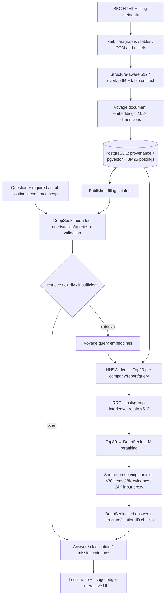

# Financial Report RAG

[English](README.md) · [简体中文](README.zh-CN.md) · [Experiments](docs/experiments.md)

An evidence-grounded research workflow for SEC annual reports: ask a multi-company, multi-year question, inspect how evidence was retrieved, and trace a cited answer back to the filing.

**Current scope:** a working local research prototype with **5 companies, 16 filings and 4,961 serving chunks**, covering HTML ingestion, query planning, retrieval, reranking and cited generation. The experiments measure evidence coverage; independent answer-quality and production-load acceptance remain ahead.


The screenshot shows a saved run, not a new live benchmark. The local UI lets you inspect each stage's input/output, actual model/SQL child calls, candidates, evidence, citations and related repository functions. See the [recorded success and failure examples](docs/examples.md) without configuring an API.

## Problem and approach

“What drove NVIDIA and AMD’s growth over three years, and did operating cash flow keep up with revenue?” Answering this requires several filings, financial tables and footnotes. A fluent summary can omit a company, mix reporting periods, or cite text that does not support a number. The project follows this research task from source preservation to an inspectable evidence path, measuring where evidence is lost.

RAG bounds the evidence supplied to generation and preserves source/date filters. Full-document context remains a useful baseline for a small number of reports; **this project has not established that RAG universally beats long-context input**. The current workflow is bounded Python, not a claim of a fully autonomous financial analyst.

## End-to-end architecture



**Current default:** HNSW dense multi-query → RRF/interleave → **LLM reranking** → cited generation. BM25 replacement, evidence-objective task regrouping and Voyage `rerank-3-lite` are optional experiment profiles. A good experimental score does not automatically change the default. No LangGraph/DeepAgents runtime is installed in this path.

Ingestion retains DOM locators, character spans and table grids, then publishes each document atomically. Unchanged sources skip embedding; conflicts are rejected before paid calls, and queries see only complete publications. A preserved table grid is not yet a normalized financial fact store with consistent metrics, units and periods.

[`serving/runtime.py:execute`](src/finrag/serving/runtime.py) orchestrates the query; algorithms and SQL live in separate modules. Ingestion uses a separate trusted CLI. [Exact parameters, storage and failure boundaries](docs/architecture.md) · [Workflow-to-code map](docs/development.md#follow-the-current-query-in-code).

## Why these choices

| Decision | Reason and tradeoff |
| --- | --- |
| SEC HTML first | Preserves table cells and source locators without a PDF/OCR service; generic PDFs and image understanding are outside current support. |
| PostgreSQL + pgvector | Keeps metadata, provenance, vectors and lexical statistics together; FAISS is useful for an in-memory vector baseline but does not supply this whole storage contract. PG still needs index/filter and load validation. |
| Structure-aware chunks + table context | Selected from v1 development controls; avoids separating tables from titles/units. Large indivisible rows can exceed the target; v1 selection does not prove v2 optimality. |
| LLM planner/reranker | Produces explicit needs/scopes and source-line relevance judgments. Adds cost/latency; schema validity is not semantic correctness. |
| Bounded Python workflow | Explicit call/budget/error boundaries with a single local service. Introduce a stateful Agent framework only when iterative tool use actually requires one. |

Dense retrieval handles wording differences, lexical retrieval complements exact terms, and RRF merges rankings. BM25 is an optional retrieval route: reranking only the existing pool cannot recover evidence that was never retrieved. The planner uses maintainable company-alias metadata rather than a fixed financial synonym replacement list; its output must still respect company, report and date constraints.

## What the experiments revealed

The initial 60-question v1 study compared five chunk configurations across 28 retrieval arms and selected structure-aware chunks with table context. Frozen-test Recall@10 was 86%, yet all evidence was recovered for only 1/5 of the cross-document subset. Finding some relevant chunks was not enough to complete a comparison.

The next development set contains **20 reviewed complex questions, 225 required evidence groups and 123 numeric checks**. All required groups must be covered, with alternative passages allowed within a group; macro recall averages each question’s coverage. Gold is loaded only for offline scoring, not planning or retrieval. Numeric checks audit reference answers; they are not an online calculator.

Stage traces exposed the bottleneck: the candidate pool averaged 177.85 chunks and 94.47% evidence recall, falling to 80.95% at Top80 and 47.34% in the unreranked rank30/8K context. Of 123 missing groups, 16 were not retrieved, 33 fell outside Top80, and 74 were inside the window but not selected. This directed work toward coarse ranking and context selection before changing embeddings or chunks together.

| Controlled 20-query development arm | Candidate evidence recall | Top80 recall | Final-context recall | All groups recovered |
| --- | ---: | ---: | ---: | ---: |
| Dense + LLM rerank |94.47%|80.95%|67.66%|4/20|
| Dense + BM25 replacement + LLM |94.77%|83.87%|71.53%|5/20|
| Evidence-objective regroup + LLM |95.62%|79.19%|67.62%|5/20|
| Dense + dedicated CrossEncoder |94.47%|80.95%|59.20%|4/20|

These are **macro source-span evidence-group recalls, not answer accuracy**. Arms use the same 342 SQL jobs, Top20/job, Top80 reranking and matched per-question context budgets; comparison retrieval is exact, reuses saved plans and mixes cached/new LLM judgments. It is not a cold end-to-end HNSW production benchmark. The BM25 gain is **3.87 percentage points** in this comparison; the service still defaults to dense+LLM.

Reranking raised final coverage to 67.66%. Full-pool LLM reranking reached 71.45% but processed more candidates. Model-selected table rows scored higher on average yet dropped interest-expense/net-income rows in U12, so compression did not become the default. Focused subqueries reached 69.81% in a separate comparison (two questions improved, 18 unchanged), while task regrouping improved the pool but reduced Top80 coverage. More candidates, finer tasks and a higher average each need per-question evidence and cost checks.

The service therefore retains bounded Top80 reranking and original table spans, with BM25 and other alternatives awaiting independent validation. [Conditions, negative results, costs and reproducibility](docs/experiments.md) · [Machine-readable aggregates and per-question results](reports/public/experiments/README.md).

## Run locally

Prerequisites: Python 3.12 and PostgreSQL with pgvector 0.8+. No Node/frontend build is needed.

```bash
git clone https://github.com/RqingLiu/financial-report-rag.git
cd financial-report-rag
python3 -m venv .venv
source .venv/bin/activate
python -m pip install -r requirements.lock
cp .env.example .env
```

Set `DATABASE_URL`, `VOYAGE_API_KEY`, `DEEPSEEK_API_KEY` and a SEC User-Agent locally. Create `financial_report_rag`, then follow [corpus/index setup](docs/data-and-ingestion.md). A fresh clone contains source manifests and evaluation labels, **not** a ready-populated database, provider credentials, raw HTML or paid caches. Uncached embedding/planning/reranking/generation incurs provider charges; saved-history reads do not.

```bash
fr-rag-serve serve --port 8000
# Open http://127.0.0.1:8000/
fr-rag-serve query "Compare Google FY2024 and Amazon FY2025 cloud revenue disclosures" --as-of 2026-10-28
```

The same loopback FastAPI service provides query/SSE, history, a read-only published-report catalog, an allowlisted code map and `/docs`. There is no authenticated public deployment. [UI, APIs and privacy](docs/trace-explorer.md).

## Current boundaries and next steps

The current bounded workflow does not yet include an autonomous Agent loop, normalized financial fact store, production calculator, forecasting or valuation service.

The corpus covers NVIDIA/Micron FY2024–2026; AMD FY2023–2025 plus an amendment; Alphabet/Amazon FY2023–2025. [Original manifest](data/sources.jsonl) · [Expansion manifest](data/generalization/sources.jsonl). Report FY, a table’s fact period and filing date are distinct. The `as_of` cutoff constrains available filings; each numeric claim still needs period and accounting-basis checks.

Reliability follows the same evidence path: planner format errors get at most one directed repair, ambiguity/missing material has explicit outcomes, and model failures are not reported as success. Billing is reserved before calls and settled afterward; unknown billing is not blindly retried. Source spans, citation IDs and admission limits are implemented, but citation existence does not prove entailment, and per-call timeouts do not establish an end-to-end SLA. This is a loopback service; business-scope filters are not tenant authorization. [Storage and failure boundaries](docs/architecture.md).

Scale tests require a separate interpretation. Across 59 filtered real-corpus queries, HNSW/exact Top20 overlap averaged 98.98%. At 100k synthetic vectors, ANN sped up full-corpus search, while selective filters could favor exact search. Expansion reused vectors without paid embedding; large fixtures have been deleted. Neighbor overlap and SQL p95 are not financial-evidence recall, end-to-end p95 or RPS. [ANN conditions and parameters](docs/experiments.md#ann与规模条件).

Next, new-intent Alphabet/Amazon questions will form a holdout untouched by tuning; the 20 questions remain development data, and paraphrases of an intent stay in the same split. Acceptance will cover evidence completeness, numbers/units/periods, citation support and partial answers when evidence is missing. Incomplete candidate relevance labels currently prevent a blanket Precision/nDCG claim. Real-corpus ANN filtering, cold/warm cost, failure injection and concurrent load follow, then a small financial-facts/calculator pilot before forecasting or valuation. [Evaluation design](docs/evaluation.md).

```bash
pytest -q
ruff check src tests --exclude src/finrag/vendor
python scripts/verify_public_evidence.py
# Requires local corpus + PostgreSQL; no paid models:
FINRAG_INTEGRATION=1 pytest -q
python scripts/build_golden_v2.py --check
```

[Current release validation](reports/public/project_guide_validation.json) · [Historical receipts](reports/public/README.md) · [Directory/code guide](docs/development.md) · [History](docs/history.md) · [Contribution guidance](CONTRIBUTING.md) · [Data/third-party notices](NOTICE.md).
