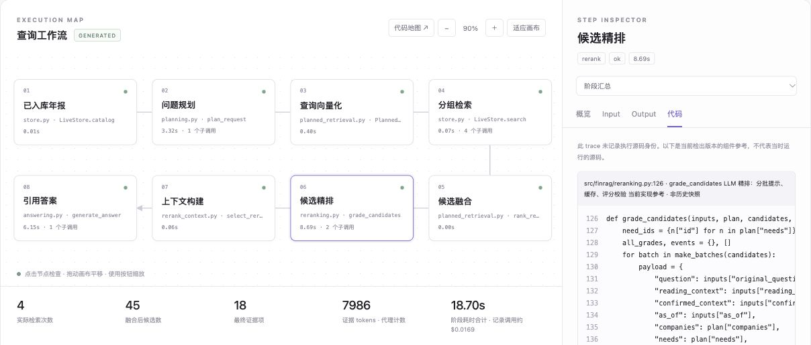
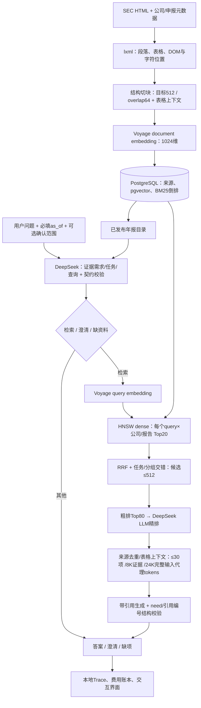

# Financial Report RAG · 财报研究与证据追踪

[English](README.md) · [简体中文](README.zh-CN.md) · [项目深挖](docs/project-deep-dive.md) · [实验与结果](docs/experiments.md)

面向 SEC 年报的研究工作流：输入跨公司、跨财年的问题，检索正文、表格与附注，生成带引用的回答，并逐步查看证据如何进入最终上下文。

**当前是可运行的本地研究原型**：覆盖5家公司、16份报告、4,961个服务用 Chunk。已实现 HTML 解析、入库、查询规划、pgvector 检索、精排、引用生成与可视化 Trace；财务事实库、确定性计算、预测、估值及自主 Agent 循环仍未实现。已测检索证据覆盖，不等于已通过独立答案正确率或生产负载验收。



截图来自已保存运行。页面支持查看每步输入/输出、实际模型与 SQL 子调用、候选去留、上下文预算、引用原文及对应源码。[无需 API 即可阅读的成功／失败案例](docs/examples.md)。

## 解决什么问题

财报比较往往横跨多份报告、表格和脚注。模型即使回答流畅，也可能漏掉一家公司、混用报告财年与表内事实期间，或给出不能支持数字的引用。本项目重点是让数据路径可解释、证据可回查，并定位漏证据发生在哪一层。

RAG 用于控制输入规模、执行来源与日期过滤、组装相关证据。少量报告全文输入仍是合理的比较基线；**尚未完成 RAG 对长上下文的系统胜负对照，不宣称 RAG 在所有问题上更好。** 当前也不是完整的自主财务分析 Agent。

## 系统怎么工作



**当前默认**：HNSW dense 多查询 → RRF/任务交错 → **DeepSeek LLM 精排** → 引用答案。BM25 替换第二条 dense 变体、按证据目标重组任务、Voyage 专用 CrossEncoder 均为可选实验配置，没有因为某次开发集分数更高就自动替换默认。

在线总编排从 [`serving/runtime.py:execute`](src/finrag/serving/runtime.py) 开始；每步调用不同模块，不是一个文件实现全部逻辑。入库走独立可信 CLI。当前不依赖 LangGraph/DeepAgents。[完整参数与存储架构](docs/architecture.md) · [逐环节代码地图](docs/development.md#follow-the-current-query-in-code)。

## 实验结果与结论

主要开发集为**20道已复核复杂问题、225个必需证据组、123项数值检查**。Gold 只参与离线评分，不进入运行时规划和检索。早期60题 v1 是另一组历史实验。

| 同预算20题开发对照 | 候选宏召回 | Top80宏召回 | 最终上下文宏召回 | 全证据齐全 |
| --- | ---: | ---: | ---: | ---: |
| Dense + LLM精排 |94.47%|80.95%|67.66%|4/20|
| Dense + BM25替换 + LLM |94.77%|83.87%|71.53%|5/20|
| 证据目标任务重组 + LLM |95.62%|79.19%|67.62%|5/20|
| Dense + 专用CrossEncoder |94.47%|80.95%|59.20%|4/20|

这里是**原文证据组覆盖率，不是答案正确率**。对照每组342次 SQL、每次 Top20、精排 Top80、逐题匹配上下文预算；使用 exact 检索以隔离方案差异，并复用已保存计划及部分 LLM 判断，不是20次独立冷启动的 HNSW 线上请求。BM25 在此对照中提升3.87个百分点；默认服务仍为 dense+LLM。

核心发现是“**候选 → 粗排窗口 → 最终上下文**”的证据损失。还做过五种切块配置／28组 v1 检索组合、上下文预算、Top80与全候选精排、聚焦子查询和 ANN 扩容实验。[实验条件、负面结果、成本边界与复现](docs/experiments.md) · [机器可读汇总及逐题结果](reports/public/experiments/README.md)。

## 为什么这样选型

| 选择 | 依据与代价 |
| --- | --- |
| 优先 SEC HTML | 保留表格网格及来源位置，减少 PDF/OCR 链路；通用 PDF、扫描件和图片理解尚不支持。 |
| PostgreSQL + pgvector | 元数据、原文、向量、来源与词法统计放在同一存储体系；FAISS 适合内存向量基线，但不能独自提供这些数据管理契约。PG 的索引、过滤和规模仍需验证。 |
| 结构切块 + 表格上下文 | 基于 v1 开发对照选择，尽量保留标题、单位与表格关系；不可分割大行可能超长，不代表该配置已在复杂 v2 上最优。 |
| LLM Planner / 精排 | 显式输出证据需求、过滤范围与原文行相关性；增加调用成本和延迟，格式合法不等于语义正确。 |
| 有界 Python 工作流 | 先落实调用、预算、缓存和错误边界；出现需要持续迭代工具调用的需求后，再评估 Agent runtime。 |

[选型替代方案、故障排查与后续验收](docs/project-deep-dive.md)。

## 本地运行

需要 Python3.12、PostgreSQL 和 pgvector0.8+，无需 Node 或独立前端构建。

```bash
git clone https://github.com/RqingLiu/financial-report-rag.git
cd financial-report-rag
python3 -m venv .venv
source .venv/bin/activate
python -m pip install -r requirements.lock
cp .env.example .env
```

本地填写 `DATABASE_URL`、`VOYAGE_API_KEY`、`DEEPSEEK_API_KEY`、真实 SEC User-Agent 联系方式；创建 `financial_report_rag` 数据库，再按[入库说明](docs/data-and-ingestion.md)准备语料与索引。新 clone 包含来源清单和评测标注，**不包含现成数据库、HTML原文、密钥及付费缓存**。缓存未命中的向量化、Planner、精排和生成会计费，历史回放不调用模型。

```bash
fr-rag-serve serve --port 8000
# 浏览器打开 http://127.0.0.1:8000/
fr-rag-serve query "比较Google FY2024和Amazon FY2025的云业务收入披露口径" --as-of 2026-10-28
```

同一 FastAPI 服务提供查询/SSE、历史回放、只读年报清单、白名单源码地图与 `/docs`；只监听本机，没有公网鉴权部署。[页面和接口说明](docs/trace-explorer.md)。

## 数据、验证与边界

- NVDA/MU FY2024–2026，AMD FY2023–2025及修订，GOOGL/AMZN FY2023–2025。报告财年、事实期间和申报日期分开处理。[原始来源](data/sources.jsonl) · [扩展来源](data/generalization/sources.jsonl)。
- 当前20题都是开发数据；新公司独立 holdout、数值/单位准确率、引用支持和拒答质量仍待验收。未完整标注候选相关性，不能报告可信的整体 Precision/nDCG。
- 来源区间、范围契约、不可变文档发布、引用编号、并发准入及费用预留已实现；这不等于保证任意财报问题正确，也不等于多租户权限系统。
- 真实小库 ANN 检查与合成1万/3万/10万向量实验分开报告。合成 SQL p95 不是用户端到端 p95，也不是 RPS。[评测边界](docs/evaluation.md)。

```bash
pytest -q
ruff check src tests --exclude src/finrag/vendor
python scripts/verify_public_evidence.py
# 依赖本地语料与数据库，不调用付费模型：
FINRAG_INTEGRATION=1 pytest -q
python scripts/build_golden_v2.py --check
```

[当前发布验证](reports/public/project_guide_validation.json) · [历史回执](reports/public/README.md) · [目录与代码指南](docs/development.md) · [演进记录](docs/history.md) · [贡献指南](CONTRIBUTING.md) · [数据与第三方声明](NOTICE.md)。
