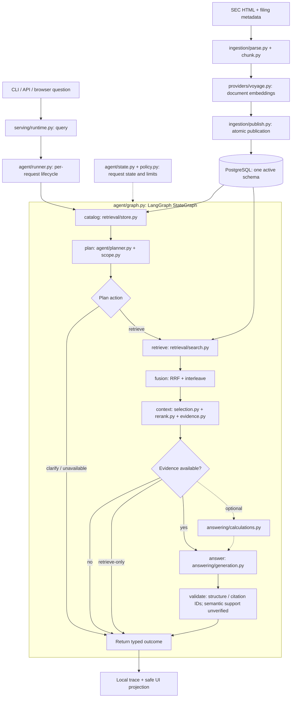

# Financial Report RAG

[English](README.md) · [简体中文](README.zh-CN.md)

从 SEC 年报检索财务证据、比较公司和财年，并查看答案怎样生成。当前本地语料是 **5 家公司、16 份财报、4,961 个 chunk**。

**资料边界：只依据已发布的财报库作答。** 补查也只查这个库，不让 Agent 自行上网。可支持部分先答，缺失部分明确无法确定及缺什么；访问 SEC 下载新资料是操作人员显式触发的入库流程。

## 先从哪里开始

- 只想提问：看“启动和查询”。
- 想找代码：看下面的目录图与 [逐文件地图](docs/repository-layout.md)。
- 想校验数据或判分：看“评测与运行命令”。
- 想理解 v2/v3、prompts 和历史材料：看“评测数据与 Prompt”。

## 整个仓库放什么

```text
financial-report-rag/
├── src/finrag/       # 可安装的 Python 包 / import finrag
│   ├── agent/       # LangGraph 状态、节点、路由、planner、限额
│   ├── ingestion/   # 下载、解析、切块、原子入库
│   ├── retrieval/   # SQL/ANN、融合、精排、上下文
│   ├── answering/   # 回答和引用校验；可选算术
│   ├── providers/   # DeepSeek/Voyage、缓存、共享计费
│   ├── core/        # 模型、配置、文件、trace
│   ├── serving/     # CLI、API/SSE、Trace Studio 页面
│   └── evaluation/  # 数据校验、批量运行、离线判分
├── configs/         # 当前服务、公司、切块配置
├── data/            # 原文、解析结果、缓存、评测数据
├── scripts/         # 6 个实际保留的运维/数据制作脚本
├── tests/           # 当前功能的回归测试
├── docs/            # 架构、流程、选型和实验结论
├── specs/           # 版本化需求/计划；不是运行组件
├── reports/         # 当前复核材料 + 可公开结果摘要
└── logs/            # 本地运行 trace，不提交 Git
```

`src` 是源码容器，`finrag` 才是可安装包和 `import finrag` 的名字。即使只有一个包，这层也有作用：安装配置能明确只收应用代码，不把 tests/data/scripts 当应用导入。保留这个标准布局，包内按业务分层。

`docs` 是实现说明；`specs` 是随迭代保留的需求/计划，编号表示开发顺序，不代表多套系统。`.env`、虚拟环境、`.git`、缓存和 trace 都不属于业务代码，也不上传。当前环境是 `.venv-migrate`，原 `.venv` 未替换。

## 代码如何串起来



`serving.cli/api → serving.runtime.query → agent.runner → agent.graph → nodes → retrieval/answering`。入库单独运行，通过 PostgreSQL 连接到问答流程；一个图节点可包含多次 SQL/模型 span，不是每个文件一个 Agent。

| 包 | 主要文件 / 入口 |
| --- | --- |
| `agent` | `runner.py` 请求生命周期；`graph.py` 条件边；`nodes.py` 阶段适配；`state.py` 业务状态；`policy.py` 限额；`planner.py` / `scope.py` 改写和范围校验 |
| `ingestion` | `acquire.py` 下载；`parse.py` HTML/表格；`chunk.py` 切块与 span；`publish.py` 原子入库；`generalization.py` 新公司 |
| `retrieval` | `store.py` SQL/HNSW/BM25；`search.py` 子查询与 RRF；`selection.py` 精排/context 编排；`rerank.py` 评分；`evidence.py` / `context.py` 选原文 |
| `answering` | `generation.py` 生成/引用校验；`calculations.py` 算术实验默认关闭 |
| `providers` / `core` | DeepSeek/Voyage、缓存、唯一计费账本 / 共用模型、设置、文件和 trace |
| `serving` | `cli.py` / `api.py` 接入；`resources.py` 资源创建；`explorer.py` / `code_view.py` 和 `static/` 展示 trace 与当前代码 |
| `evaluation` | `__main__.py` 唯一命令分发；`run.py` 实跑；`answers.py` 逐项判分；`rubric.py` 五维评分；`evidence.py` span recall |

默认 HNSW dense Top20/search → RRF/交错 → ≤512 候选 → Top80 LLM 精排 → 8K evidence / 24K 输入。BM25、CrossEncoder 和算术是可选项，未因整理改默认。LangGraph 有界执行；自动证据补查、持久 checkpoint 和多 Agent 尚未启用。证据 gate 只检查有无证据，不是语义正确性认证。

## 启动和查询

```bash
# 在项目根目录执行。本机已安装环境：
source .venv-migrate/bin/activate

# 第一次安装：Python 3.12；运行依赖与完整评测依赖二选一
# python3 -m venv .venv-migrate
# python -m pip install -r requirements.lock
# python -m pip install -r requirements-evaluation.lock
# cp .env.example .env   # 填数据库、Voyage、DeepSeek、SEC User-Agent

python -m finrag.serving.cli serve --port 8000
# 浏览器打开 http://127.0.0.1:8000/
python -m finrag.serving.cli query "比较 NVDA 和 AMD 的 FY2025 数据中心业务" --as-of 2026-11-08
```

## 评测与运行命令

命令中的 `python` 指已经激活的 `.venv-migrate`。查询和批量实跑可能调用模型；校验、导出 Judge prompt、导入判定和判分都在离线完成。

| 命令（均在项目根目录） | 输入 → 输出 / 用途 | 费用或写入 |
| --- | --- | --- |
| `python -m finrag.serving.cli --help` | 全部运行命令与参数 | 无 |
| `python -m finrag.serving.cli serve --port 8000` | 启动页面、API、SSE、代码地图 | 启动本身不调用模型 |
| `python -m finrag.serving.cli query "问题" --as-of 2026-11-08` | 原问 → 引用答案，trace 写入 `logs/serving/` | 未缓存调用收费 |
| 上一条追加 `--retrieve-only` | planner → retrieval → rerank → context，跳过答案 | 仍可能收费，不是纯检索免费模式 |
| `python -m finrag.serving.cli init` | 当前配置 → 初始化当前 schema | 写 DB |
| `python -m finrag.serving.cli download` | `data/sources.jsonl` → `data/raw/*.html` | 访问 SEC；不调用模型 |
| `python -m finrag.serving.cli ingest --html FILE --metadata META.json` | HTML＋Filing/Company JSON → 原子发布 | 写 DB；新 embedding 可能收费 |
| `python -m finrag.serving.cli ann --kind hnsw` | 当前 chunks → HNSW 索引；也支持 `ivfflat` | 写 DB、占用构建资源 |
| `python -m finrag.serving.cli aliases --metadata configs/serving_company_aliases.json` | 可信别名 JSON → 公司元数据 | 写 DB，无模型调用 |
| `python -m finrag.ingestion.generalization download` | 新公司 manifest → 原文 | 访问 SEC |
| 同一入口 `prepare` / `publish` | 预检/费用估计 / 明确发布新公司 | prepare 不调模型；publish 可能收费 |
| `python -m finrag.evaluation --help` | 全部评测子命令 | 无 |
| `python -m finrag.evaluation check-data` | 校验 20 题 release＋81 题 draft | 离线、不改标签 |
| 同一入口 `check-data --dataset compound` / `--dataset intents` | 只校验指定数据集 | 离线 |
| 同一入口 `build-intents` | 父题答案＋split specs → 重建 81 题草案 | 离线；会写草案，不覆盖 20 题 release |
| `python -m finrag.evaluation run --ids U11 --out reports/current/new-run` | query-only 数据 → 实际 pipeline 回答/trace/usage | 未缓存调用收费，遵守原账本停止线 |
| `python -m finrag.evaluation prepare-judge --help` | 保存的 trace＋gold → 审核/判分 packet | 离线 |
| 同一入口 `export-judge --help` | packet＋rubric → 可在个人对话中使用的 Judge prompt | 离线，不代发模型请求 |
| 同一入口 `score --help` | packet＋已导入判定 → scores.json / review.md | 离线 |
| `python -m pytest -q` | 当前功能回归 | 无付费 API；DB 测试默认跳过 |
| `FINRAG_INTEGRATION=1 python -m pytest tests/test_serving_database.py -q` | 临时 schema 的入库/ANN/图对照 | 写入并删除临时 DB 数据，无付费模型 |

`fr-rag-serve` / `fr-rag` 都是 `python -m finrag.serving.cli` 的别名。单份 metadata 格式与 manifest 入库见 [入库说明](docs/data-and-ingestion.md)。`run --retrieve-only` 会跳过答案，但仍执行 Planner 和精排。不要把它当作 R0 的纯检索实验。

## scripts 里每个文件是什么

| 保留脚本 | 为什么保留 | 触发方式 / 输入输出 |
| --- | --- | --- |
| `scripts/ingest_manifest.py` | 一次导入一个 manifest 的所有财报 | `python scripts/ingest_manifest.py --manifest data/sources.jsonl --companies configs/companies.json` 先只看清单；追加 `--publish` 才发布。读取 `data/raw/`，写 DB/缓存，可能收费 |
| `scripts/inspect_database.sql` | pgAdmin 直接查看文档、chunk、span、向量维度与索引 | 在 Query Tool 中打开执行；只读 |
| `scripts/build_golden_v2.py` | **已审核 20 题的冻结制作配方/校验器**；原路径也写入来源 hash，所以保留文件名 | 推荐 `python -m finrag.evaluation check-data --dataset compound`；直接 `python scripts/build_golden_v2.py --check` 等价。需原文和解析文件；已发布时仅校验 |
| `scripts/build_golden_v3.py` | **把 20 题拆成 81 个规范意图草案**，不是另一个生产检索方案 | 推荐 `python -m finrag.evaluation build-intents`；直接运行脚本重建，`--check` 检查一致性。输入父题与 `split_specs.json`，输出 v3 草案 |
| `scripts/check_publication.py` | 提交前扫描实际 Git 暂存区的密钥/私密路径/大文件 | `python scripts/check_publication.py`；只读，不执行 git add/commit/push |
| `scripts/verify_public_evidence.py` | 复算已公开实验摘要并检查文档链接 | `python scripts/verify_public_evidence.py`；不需要数据库、原始大 trace 或模型 |

## 评测数据与 Prompt

| 数据 / 目录 | 用途与状态 |
| --- | --- |
| `data/sources.jsonl` / `data/generalization/sources.jsonl` | 财报 URL、公司、财年、披露日、accession、原文 hash |
| `data/raw/` / `data/processed/` | 本地 HTML 和规范文本/block/span，入库与证据校验用；不提交 Git |
| `data/cache/` | 已付费 embedding、精排结果和共享预算账本；不随清理删除、不提交 Git |
| `data/evaluation/golden_v2/` | 原始 20 道复合开发题，已审核答案/证据/数值检查；**不是生产用户流量或独立 holdout** |
| `data/evaluation/golden_v3/` | 81 个规范意图草案、父子映射、各自答案与评分点；**待复核，不证明口语改写质量** |
| `data/evaluation/user_seeds_v2.jsonl`、`review_v2/` | 20 题冻结配方仍实际读取的原问题与两份审核记录 |
| `golden_v1.jsonl`、`freeze_v1.json`、`ragas_reference.jsonl`，以及 `configs/best.json` / `reports/test_release.json` | 早期冻结来源的 hash 锚点，20 题校验器仍核对它们；不是另一套在线数据/配置。其余旧制题 prompt、draft 和实验已移除 |
| `reports/current/` | 紧凑历史回答＋实际证据＋Judge 判定和比较结果；本地复核用，不提交 Git |
| `reports/public/` | 可公开的小型实验结果、验证与清理回执；旧实验源程序已退休，结果条件保留 |
| `logs/` | 当前请求 trace；可通过页面回看，属于本地诊断材料 |

v2 / v3 是**标注数据的版本**：20 道复合题与 81 个派生意图用途不同，不能直接比较两者平均分。`answer_specs.json` / `label_specs.json` 是拆题配方的输入；`golden.jsonl` / `rubrics.jsonl` / `numeric_checks.jsonl` 是评分标签；`retrieval_queries.jsonl` 只含请求字段，才可以给运行系统。详见 [数据集说明](data/evaluation/README.md)。

顶层 `prompts/` 原先存的是早期手工制题/参考答案模板，已删除。当前真正执行的 Prompt 与其代码放一起：

- `agent/planner.py:PLANNER_PROMPT`：理解/改写/拆解。
- `retrieval/rerank.py:RERANK_PROMPT`：精排。
- `answering/generation.py:ANSWER_PROMPT`：依据证据回答。
- `evaluation/rubric.py:judge_inputs`：离线构造 Judge prompt；五维锚点见 `specs/009-answer-evaluation/contracts/whole_answer_rubric.json`。

改运行 Prompt 要按同一数据和 rubric 做对照，不能把原文、参考答案或 Judge 标签塞入在线计划。

## 用已保存回答生成审核材料

```bash
python -m finrag.evaluation prepare-judge   --traces reports/current/current_default_20/traces   --golden data/evaluation/golden_v2 --ids U11   --out reports/current/review/packets.json
python -m finrag.evaluation export-judge   --packets reports/current/review/packets.json   --rubric specs/009-answer-evaluation/contracts/whole_answer_rubric.json   --out reports/current/review/judge-prompts.json
# 在个人对话或人工复核后保存 verdicts.json / whole-verdicts.json，再离线 score：
python -m finrag.evaluation score --packets reports/current/review/packets.json   --verdicts reports/current/review/verdicts.json   --rubric specs/009-answer-evaluation/contracts/whole_answer_rubric.json   --whole-verdicts reports/current/review/whole-verdicts.json   --out reports/current/review/scored
```

导出不替你生成 Judge 判定。判定必须符合 packet/rubric hash 与来源摘录校验，人工校准仍是必要步骤；引用 ID 存在不代表支持主张。

## 实验发现了什么

早期 v1 比较了五种切块配置和 28 组检索组合。冻结测试集 Recall@10 为 **86%**，但跨文档子集中，只有 **1/5** 的问题找齐了全部必需证据。

后续开发集包含 **20 道已复核问题、225 个必需证据组、123 项参考答案数值检查**。每组对应一项必需事实或原文，可以允许多个替代来源。“宏平均召回”是先算每题找到了多少必需证据，再对所有题取平均。参考答案和标签只用于离线评分。

[v3拆分草案](data/evaluation/golden_v3/README.md)将其整理为 **81个规范意图用例**，分别分配答案与评分要求；这不是81个新增独立测试样本，原20题仍保留作复合查询压力测试。子题措辞已经规整，不能证明真实输入的改写效果；需另做 [raw-query 配对评测](docs/evaluation.md#raw-query-and-rewrite-evaluation)。[父子题对应表](data/evaluation/golden_v3/parent_child_map.md) · [RAG Agent重构提案](docs/rag-agent-refactor.md)（已完成等价迁移，补查仍待实现）。

Trace 显示，主要损失发生在召回之后：候选池证据覆盖 **94.47%**，进入前 80 名后是 **80.95%**，未经精排、最终送给模型的上下文只有 **47.34%**。因此后续重点测试排序和上下文选择，并固定每题的上下文预算。

| 20 题开发集对照 | 候选池召回 | 前 80 名召回 | 最终上下文召回 | 证据齐全的题数 |
| --- | ---: | ---: | ---: | ---: |
| 向量检索 + LLM 精排 | 94.47% | 80.95% | 67.66% | 4/20 |
| 向量 + BM25 替换一路查询 + LLM | 94.77% | 83.87% | 71.53% | 5/20 |
| 按取证目标重组任务 + LLM | 95.62% | 79.19% | 67.62% | 5/20 |
| 向量检索 + 专用 CrossEncoder | 94.47% | 80.95% | 59.20% | 4/20 |

这些分数是**证据召回率，不是答案正确率**。每组执行 342 次 SQL 检索，每次取 Top20，精排前 80 个候选，每题上下文预算相同。对照使用精确检索、已保存的计划和部分复用的 LLM 评分，不是端到端冷启动性能测试。BM25 在这里提升了 3.87 个百分点；默认仍保留向量检索 + LLM，等待独立测试。

其他实验也说明不能只看均分：全候选精排达到 71.45%，但精排成本更高；模型选取表格行的均分更高，却漏掉 U12 的重要会计行。聚焦子查询在另一组实验中达到 69.81%。完整条件、费用、逐题退步和 ANN 结果见[实验文档](docs/experiments.md)与[逐题 JSON](reports/public/experiments/README.md)。


## 当前边界与下一步

当前证据 recall 是定位中间损失的指标，不能当回答正确率。20 题和 81 个派生意图都属于开发材料；真实 raw-query 配对、独立新公司问题、数值/引用支持及拒答评测仍需要继续。没有新的付费评测结果，也不声称框架迁移提升了答案分数。

旧研究 driver、synthetic benchmark 源码、过期标注 prompt、重复维护脚本和整个 `archive` 已删除；保留的历史分数注明条件，不再承诺从已删除的原始大 trace 重放。当前运行、数据校验与判分不依赖 archive。

[当前架构](docs/architecture.md) · [入库](docs/data-and-ingestion.md) · [评测方法](docs/evaluation.md) · [Trace Studio](docs/trace-explorer.md) · [实验摘要](reports/public/experiments/README.md)

## 开发辅助目录与自动生成文件

| 路径 | 用途 / 是否手工维护 |
| --- | --- |
| `.github/` | GitHub CI：安装完整评测依赖、检查代码/公开材料、跑测试 |
| `.specify/`、`.agents/skills/` | Spec Kit 的模板、当前 feature 指针和开发指令；不会成为在线 Agent 的工具 |
| `specs/` | 需求、计划和验收记录；当前 013 是本轮整理，009/010/012 分别对应评测、数据和 Agent |
| `.venv-migrate/` / `.venv/` | 已验证的新运行环境 / 保留的旧环境；本轮没有重装或删除环境 |
| `.pytest_cache/`、`.ruff_cache/`、`__pycache__/` | 测试、lint、Python 自动缓存，不是手写业务代码，不提交 Git，可再生成 |
| `src/*.egg-info/` | editable install 自动生成的包元数据，不作为源码编辑 |
| `.git/`、`.gitignore` | 版本历史 / 提交排除规则 |
| `.env` / `.env.example` | 本地秘密配置 / 不含秘密的配置模板 |
| `pyproject.toml`、两个 `requirements*.lock` | 包布局、CLI 名称和依赖 / 运行与完整评测的版本锁定 |
| 本地 `AGENTS.md` | 本地开发指令，不提交；贡献约定与数据许可见下文 |

模块里的 `__init__.py` 标记包；`evaluation/__main__.py` 让 `python -m finrag.evaluation` 成为命令入口。其他业务 `.py` 通常由图节点导入调用，不需要逐个直接执行。

## 开发与贡献

先看 [开发说明](docs/development.md)和 `specs/` 中对应的需求。运行输入与评测标签分开，保留来源和财年信息，行为变化时补充回归检查。不要覆盖冻结标签或实验对照来提高分数。

暂存改动后运行测试及 `python scripts/check_publication.py`。数据库检查需显式开启，付费 API 实验需有明确预算。密钥、缓存和完整本地回答不提交。检索改动说明数据划分、固定预算、候选池/Top80/上下文召回及退步；生成改动分别评估完整性、数值和引用支持，不把格式通过当作答案正确。

## 数据与许可

财报来自 SEC EDGAR，来源清单保留链接和校验和。公司披露与第三方陈述不属于本项目的原创研究。PageIndex 辅助代码已随旧树检索实验移除；历史版本保留其上游来源和许可声明。

项目尚未选择整体开源许可。仓库公开不等于授予所有材料的使用许可，第三方组件仍遵循各自条款。
