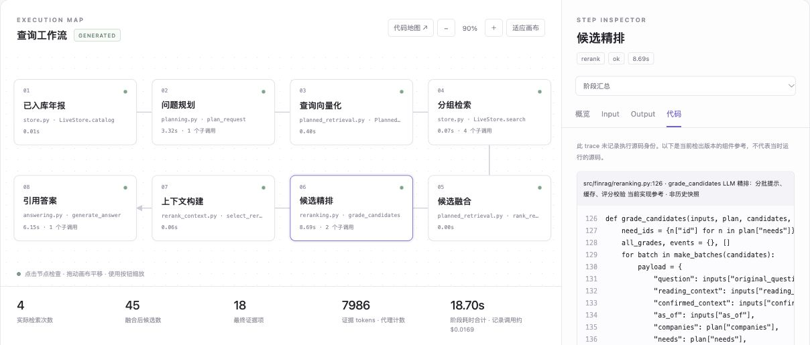
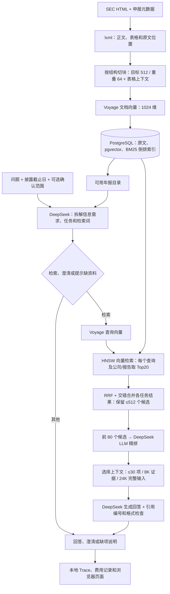

# Financial Report RAG · 财报检索与问答

[English](README.md) · [简体中文](README.zh-CN.md) · [实验与结果](docs/experiments.md)

检索 SEC 年报，比较不同公司和财年的披露，并查看每条答案的原文依据。

本地应用目前包含 **5 家公司、16 份报告、4,961 个文本块**。已实现 HTML 正文与表格解析、问题拆解、检索、精排和带引用的回答。Trace 页面可以查看每一步的输入、输出、模型与 SQL 调用，以及对应代码。



截图来自已保存的运行。[查看一次完成的查询和一次失败记录](docs/examples.md)，无需配置 API。

## 要解决什么问题

“NVDA 和 AMD 过去三年的增长来自哪些产品？经营现金流是否跟上收入？”回答这类问题，通常需要查多份报告、表格和附注，还要确认公司、期间和会计口径一致。

这个项目把检索过程展示出来，方便检查证据是在搜索、排序还是选入上下文时丢失的。RAG 用来控制送给模型的文本量，并按公司和披露日期过滤资料。如果只有少量报告，也可以直接输入全文；本项目尚未对这两种方式做效果对照。

## 系统怎么工作



**当前默认：** HNSW 向量检索 → RRF/合并各任务结果 → DeepSeek LLM 精排 → 带引用的回答。BM25 召回、任务重组和 Voyage `rerank-3-lite` 是可选实验方案。图中 token 限制使用本地 tokenizer 估算，与服务商计费数量可能不同。

[`serving/runtime.py:execute`](src/finrag/serving/runtime.py) 串联查询的各个步骤。入库使用独立 CLI：保留原文位置和表格结构，未变化的文档跳过向量化，每份文档通过一个事务写入；查询只读取已完成入库的文档。

[详细参数与数据库表](docs/architecture.md) · [每个步骤对应哪些代码](docs/development.md#follow-the-current-query-in-code)

## 为什么这样选型

| 选择 | 原因和代价 |
| --- | --- |
| SEC HTML | 可以直接保留表格和原文位置，减少 OCR 处理。目前不支持 PDF 和图片。 |
| PostgreSQL + pgvector | 原文、元数据、向量和关键词索引放在一起。单用 FAISS 仍需要另外管理文档和元数据。 |
| 按结构切块 | 尽量让表格标题、单位和数据行保持在一起。根据 v1 开发集选择，较长且不可拆的行可能超出目标长度。 |
| LLM 规划与精排 | 拆解复杂问题，判断候选是否与所需信息相关；增加模型费用和延迟，输出格式正确也可能判断错误。 |
| Python 工作流 | 调用顺序、数量限制和错误处理都比较明确，目前固定流程不需要 LangGraph/DeepAgents。 |

向量检索处理不同表述，关键词检索补充精确术语，RRF 合并各路排名。公司名称和别名放在元数据里，新增公司不需要修改 Python 中的公司列表。

## 实验发现了什么

早期 v1 比较了五种切块配置和 28 组检索组合。冻结测试集 Recall@10 为 **86%**，但跨文档子集中，只有 **1/5** 的问题找齐了全部必需证据。

后续开发集包含 **20 道已复核问题、225 个必需证据组、123 项参考答案数值检查**。每组对应一项必需事实或原文，可以允许多个替代来源。“宏平均召回”是先算每题找到了多少必需证据，再对所有题取平均。参考答案和标签只用于离线评分。

Trace 显示，主要损失发生在召回之后：候选池证据覆盖 **94.47%**，进入前 80 名后是 **80.95%**，未经精排、最终送给模型的上下文只有 **47.34%**。因此后续重点测试排序和上下文选择，并固定每题的上下文预算。

| 20 题开发集对照 | 候选池召回 | 前 80 名召回 | 最终上下文召回 | 证据齐全的题数 |
| --- | ---: | ---: | ---: | ---: |
| 向量检索 + LLM 精排 | 94.47% | 80.95% | 67.66% | 4/20 |
| 向量 + BM25 替换一路查询 + LLM | 94.77% | 83.87% | 71.53% | 5/20 |
| 按取证目标重组任务 + LLM | 95.62% | 79.19% | 67.62% | 5/20 |
| 向量检索 + 专用 CrossEncoder | 94.47% | 80.95% | 59.20% | 4/20 |

这些分数是**证据召回率，不是答案正确率**。每组执行 342 次 SQL 检索，每次取 Top20，精排前 80 个候选，每题上下文预算相同。对照使用精确检索、已保存的计划和部分复用的 LLM 评分，不是端到端冷启动性能测试。BM25 在这里提升了 3.87 个百分点；默认仍保留向量检索 + LLM，等待独立测试。

其他实验也说明不能只看均分：全候选精排达到 71.45%，但精排成本更高；模型选取表格行的均分更高，却漏掉 U12 的重要会计行。聚焦子查询在另一组实验中达到 69.81%。完整条件、费用、逐题退步和 ANN 结果见[实验文档](docs/experiments.md)与[逐题 JSON](reports/public/experiments/README.md)。

## 本地运行

需要 Python 3.12、PostgreSQL 和 pgvector 0.8+，无需构建独立前端。

```bash
git clone https://github.com/RqingLiu/financial-report-rag.git
cd financial-report-rag
python3 -m venv .venv
source .venv/bin/activate
python -m pip install -r requirements.lock
cp .env.example .env
```

在 `.env` 填写 `DATABASE_URL`、`VOYAGE_API_KEY`、`DEEPSEEK_API_KEY` 和 SEC User-Agent 联系方式。创建 `financial_report_rag` 数据库，再按[入库说明](docs/data-and-ingestion.md)准备数据。仓库包含来源清单和评测标签；年报原文、数据库、密钥和模型缓存需要在本地准备。未命中缓存的模型调用会计费，已保存运行的回放不调用模型。

```bash
fr-rag-serve serve --port 8000
# 浏览器打开 http://127.0.0.1:8000/
fr-rag-serve query "比较Google FY2024和Amazon FY2025的云业务收入披露口径" --as-of 2026-10-28
```

FastAPI 提供查询、实时 Trace、历史记录、年报目录、代码查看和 `/docs`。服务只监听本机，尚未配置公网访问鉴权。[页面与接口说明](docs/trace-explorer.md)。

## 当前限制和下一步

- **数据：** NVDA/MU FY2024–2026，AMD FY2023–2025 及修订，GOOGL/AMZN FY2023–2025。报告财年、表内数字期间和申报日期分开处理，`as_of` 限制当时已公开的报告。[原始来源](data/sources.jsonl) · [新增公司](data/generalization/sources.jsonl)。
- **答案：** 已检查引用编号和输出格式；数字是否正确、引用能否支持结论仍需评测。保存的表格还不是统一口径的财务事实库。计算器、预测、估值和自主 Agent 循环尚未实现。
- **错误与费用：** 非法计划最多修复一次，问题有歧义或资料不足时明确返回。调用前预留费用，计费未知时保留预留、不盲目重试。已有并发数量限制和单次调用超时，生产并发能力及端到端延迟尚未验证。[实现细节](docs/architecture.md)。
- **规模：** 真实语料 ANN 检查和合成 1 万/3 万/10 万向量实验分开报告。合成数据上的 SQL 延迟不能代表服务吞吐或财报证据召回。[ANN 实验](docs/experiments.md#ann与规模条件)。

下一步用 GOOGL/AMZN 的新问题类型建立独立测试集，检查数字、引用和缺证据时的回答，再测试真实扩库与并发。同一问题的口语变体放在同一数据划分。财务事实提取和确定性计算先做小范围对照，再考虑预测。[评测方案与指标定义](docs/evaluation.md)。

```bash
pytest -q
ruff check src tests --exclude src/finrag/vendor
python scripts/verify_public_evidence.py
# 需要本地语料与数据库，不调用付费模型：
FINRAG_INTEGRATION=1 pytest -q
python scripts/build_golden_v2.py --check
```

[发布验证](reports/public/project_guide_validation.json) · [历史结果](reports/public/README.md) · [开发指南](docs/development.md) · [演进记录](docs/history.md) · [贡献指南](CONTRIBUTING.md) · [数据声明](NOTICE.md)
