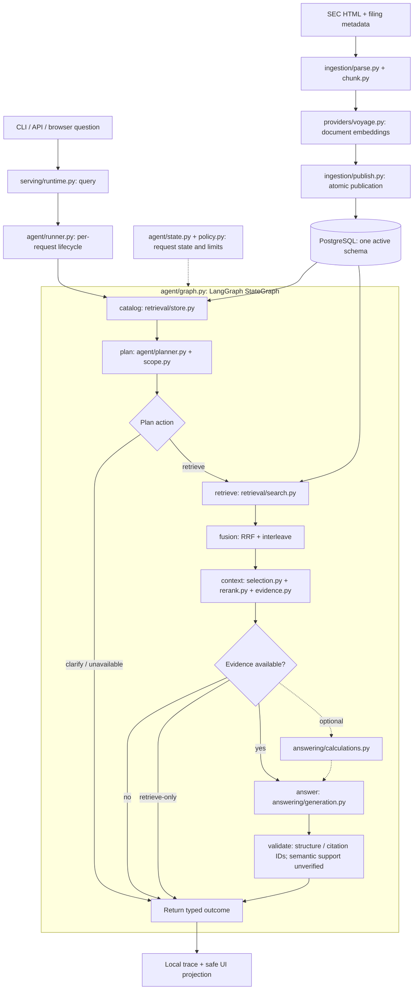

# Financial Report RAG

[English](README.md) · [简体中文](README.zh-CN.md)

## 项目简介

基于 Python、LangGraph、PostgreSQL/pgvector、Voyage embedding 和 DeepSeek 的 SEC 年报研究应用。支持公司与财务期间问答，答案附原文引用，并可查看每一步如何得到结果。当前已发布语料含 **5 家公司、16 份财报、4,961 个 chunk**；仓库保存来源清单，数据库和原始文件需单独准备。

- 解析 SEC HTML 和表格，保留 block/chunk 与原文位置，按文档原子入库。
- 将问题转为经过范围校验的计划，检索、精排证据，再生成引用答案；缺少期间时合理说明，关键歧义先澄清。
- 在本地工作台查看节点 State 变化、耗时、内部调用、证据和代码位置。
- 统一请求/累计预算、attempts、协作式 deadline 与取消控制。

答案只使用已发布的资料库，Agent 不会自主上网。预测、估值、自动补查循环和持久多轮记忆尚未实现。

## 评测与实验结果

### 最新端到端基线：41 题

**运行：2026-11-11；离线评分：2026-11-12。开发集初评，等待人工校准。** 41 题全部尝试，38 题生成答案，3 题在 Planner 范围校验阶段失败。这些规范意图来自 **20 个父问题族**，不是 41 个独立用户问题或独立测试集。包含 12 条此前已采纳的 pilot 参考，其余 29 条由 Agent 对照财报原文审计。

本集有 37 道正证据题、4 道纯披露边界题、166 个必需证据组、80 个必答事实，75 项不同数值检查共应用 84 次。本节对应保存的 baseline 快照。之后的 Demo、预算和时间范围 Planner 修改**尚未重跑全量评测**。下方历史检索实验的问题与标签不同，不能据此宣称分数提升。

| 端到端指标 | 结果 | 定义 / 分母 |
| --- | ---: | --- |
| 答案交付 | **38/41（92.68%）** | 3 道 Planner 失败仍保留在总尝试数中 |
| 严格整题通过 | **26/41（63.41%）** | 必答事实、数字、边界、行为均满足且无实质错误；其余为 12 道审核未通过、3 道运行失败 |
| 必答事实完整性 | **66/80（82.50%）** | 正确 1 分、部分 0.5 分、漏答/未交付 0 分 |
| 必需数值正确交付 | **70/84（83.33%）** | 25 次精确正确、45 次合理舍入；6 次漏答、8 次未交付 |
| 已陈述必答事实的完整引用支持 | **61/65（93.85%）** | 另 4 项部分支持；仅在实际答出的适用事实中统计 |
| 必需引用交付覆盖 | **61/73（83.56%）** | 包括漏答/失败；7 项分析边界 N/A；按全部事实计算为 61/80（76.25%） |
| 存在实质错误的题数 | **5/41** | 包含预设数值检查未覆盖的额外错误 |
| 技术失败率 | **3/41（7.32%）** | Planner 范围校验失败，不是财报未披露 |

实际答出且映射到预设检查的数值为 70/70 正确，**不代表全文所有数字正确率为 100%**。额外审查发现了一处不在预设数值清单中的十倍单位错误。

| 整体回答 rubric（1–5 分） | 已生成答案均分（n=38） | 含失败的交付调整均分（n=41） |
| --- | ---: | ---: |
| 完整性 Completeness | 4.45 | 4.12 |
| 真实性 Truthfulness | 4.32 | 4.00 |
| 证据忠实度 Faithfulness | 4.32 | 4.00 |
| 相关性 Relevance | 3.45 | 3.20 |
| 清晰度 Clarity | 3.34 | 3.10 |

未交付答案在原 rubric 中为 N/A；交付调整列以各维分数之和除以 41，未交付贡献 0。它是交付惩罚，不是原 rubric 的 0 分锚点，也不把五维平均包装成“准确率”。

| 阶段证据覆盖诊断 | 有实际检索记录的正证据题（n=34） | 全部正证据题的已确认覆盖下界（n=37） |
| --- | ---: | ---: |
| 候选池 | 93.15% | 85.60% |
| 粗排 Top80 | 87.97% | 80.84% |
| 实际送入生成器的 context | 78.55% | 72.18% |

先按每题必需证据组计算覆盖，再做宏平均，匹配实际来源 span。全量下界将 3 道检索前失败记为未覆盖；4 道纯披露边界题的正证据 Recall 为 N/A。Precision@k、MRR、nDCG、RAGAS Context Precision/Recall **尚未实测**。

**条件与成本。** 通过与 CLI/API 共用的 LangGraph 链路串行实跑；DeepSeek Flash 负责规划、LLM 精排与生成，Voyage 4-lite（1024 维），HNSW dense 每 job Top20、RRF/交错、Top80 LLM 精排，证据 8K / 输入 24K proxy-token 上限。未启用 hybrid、专用 CrossEncoder、regroup 或确定性计算工具。整轮保守标价费用 **$0.91794642**（约 $0.0224/次），低于批准的 $1.10；232 次 provider attempt、194 次逻辑 LLM 调用、512 次 SQL attempt。Planner/精排缓存均零命中，文档向量复用。请求耗时中位数 **25.13 秒**、经验 p95 **32.88 秒**；这是串行样本，不是并发性能承诺。费用为估算，不等于最终账单。

**怎么评分。** 读取保存的答案及生成器实际收到的证据，在本对话中按固定五维 rubric 填写逐项判定，再由代码检查 hash、原文摘录、引用附着、日期和 Decimal 数值，离线汇总。没有付费 Judge 或 RAGAS 评分调用；这不是独立盲评，语义判定仍待人工校准。[五维 rubric](specs/009-answer-evaluation/contracts/whole_answer_rubric.json) · [评测方法](docs/evaluation.md) · [41 题参考与数据说明](data/evaluation/baseline41/README.md) · [公开汇总、逐题分数及来源 hash](reports/public/baseline41.json)。

**主要错误。** U06.02/.03/.06 在 Planner 范围校验中止；实质错误涉及假缺项（U02.04）、业务/报告分部可比性（U11.01/.03）、季度与年度操作数错配（U15.07）、billion→亿换算（U19.02）。U04.02 的实际 context 还缺收入输入。阶段 Recall 用于定位，不能单凭低 Recall 判断答案错误的原因。

[逐层归因：每步改了什么、贡献多少、为什么有效、退步及尚缺的消融](docs/experiments.md#stage-contributions)。

### 早期检索实验

早期五种切块、28 组检索组合的冻结测试 Recall@10 为 **86%**，但跨文档题只有 **1/5** 找齐全部证据。后续 20 道复合开发题采用 225 个必需证据组，并固定各题上下文预算：

| 20 题检索对照 | 候选池召回 | Top80 召回 | 最终 context 召回 | 证据齐全 |
| --- | ---: | ---: | ---: | ---: |
| Dense + LLM 精排 | 94.47% | 80.95% | 67.66% | 4/20 |
| Dense + BM25 替换一路查询 + LLM | 94.77% | 83.87% | 71.53% | 5/20 |
| 按取证目标重组任务 + LLM | 95.62% | 79.19% | 67.62% | 5/20 |
| Dense + 专用 CrossEncoder | 94.47% | 80.95% | 59.20% | 4/20 |

这些是**证据召回对照，不是答案质量或同期 A/B 实验**。各组使用 342 次 SQL、精确向量检索、每 job Top20、Top80 精排窗口、保存的计划和部分复用评分。默认仍为 Dense + LLM，没有仅凭 BM25 的局部分数就认定泛化收益。全候选精排达到 71.45%，但成本更高；另一次聚焦查询实验达到 69.81%。其他答案/算术跟进、退步及 ANN 条件见[实验说明](docs/experiments.md)和[公开实验依据](reports/public/experiments/README.md)。

## 代码如何串起来



`serving.cli/api → serving.runtime.query → agent.runner → agent.graph → nodes → retrieval/answering`。入库单独运行，通过 PostgreSQL 连接到问答流程；一个图节点可包含多次 SQL/模型 span，不是每个文件一个 Agent。

| 包 | 主要文件 / 入口 |
| --- | --- |
| `agent` | `runner.py` 请求生命周期；`graph.py` 条件边；`nodes.py` 阶段适配；`state.py` 业务状态；`policy.py` 限额；`planner.py` / `scope.py` 改写和范围校验 |
| `ingestion` | `acquire.py` 下载；`parse.py` HTML/表格；`chunk.py` 切块与 span；`publish.py` 原子入库；`generalization.py` 新公司 |
| `retrieval` | `store.py` SQL/HNSW/BM25；`search.py` 子查询与 RRF；`selection.py` 精排/context 编排；`rerank.py` 评分；`evidence.py` / `context.py` 选原文 |
| `answering` | `generation.py` 生成/引用校验；`calculations.py` 算术实验默认关闭 |
| `providers` / `core` | DeepSeek/Voyage、缓存、唯一计费账本 / 共用模型、设置、文件和 trace |
| `serving` | `cli.py` / `api.py` 接入；`resources.py` 资源创建；`explorer.py` / `code_view.py` 和 `static/` 展示 trace 与当前代码 |
| `evaluation` | `__main__.py` 命令分发；`run.py` 实跑；`answers.py` / `rubric.py` 答案判分；`evidence.py` span recall；`dataset.py` 小集校验；`benchmark.py` 离线诊断和比较 |

默认 HNSW dense Top20/search → RRF/交错 → ≤512 候选 → Top80 LLM 精排 → 8K evidence / 24K 输入。BM25、CrossEncoder 和算术是可选项，未因整理改默认。LangGraph 有界执行；自动证据补查、持久 checkpoint 和多 Agent 尚未启用。证据 gate 只检查有无证据，不是语义正确性认证。

## 整个仓库放什么

```text
financial-report-rag/
├── src/finrag/       # 可安装的 Python 包 / import finrag
│   ├── agent/       # LangGraph 状态、节点、路由、planner、限额
│   ├── ingestion/   # 下载、解析、切块、原子入库
│   ├── retrieval/   # SQL/ANN、融合、精排、上下文
│   ├── answering/   # 回答和引用校验；可选算术
│   ├── providers/   # DeepSeek/Voyage、缓存、共享计费
│   ├── core/        # 模型、配置、文件、trace
│   ├── serving/     # CLI、API/SSE、Trace Studio 页面
│   └── evaluation/  # 数据校验、批量运行、离线判分
├── configs/         # 当前服务、公司、切块配置
├── data/            # 原文、解析结果、缓存、评测数据
├── scripts/         # 6 个实际保留的运维/数据制作脚本
├── tests/           # 当前功能的回归测试
├── docs/            # 架构、流程、选型和实验结论
├── specs/           # 版本化需求/计划；不是运行组件
├── reports/         # 当前复核材料 + 可公开结果摘要
└── logs/            # 本地运行 trace，不提交 Git
```

`src` 是源码容器，`finrag` 才是可安装包和 `import finrag` 的名字。即使只有一个包，这层也有作用：安装配置能明确只收应用代码，不把 tests/data/scripts 当应用导入。保留这个标准布局，包内按业务分层。

`docs` 是实现说明；`specs` 是随迭代保留的需求/计划，编号表示开发顺序，不代表多套系统。`.env`、虚拟环境、`.git`、缓存和 trace 都不属于业务代码，也不上传。虚拟环境名称不影响运行；以下安装示例使用 `.venv`。

## 安装与本地 Demo

真实查询需要 Python 3.12、安装 pgvector 的 PostgreSQL，以及 DeepSeek/Voyage 凭证。新克隆的仓库不包含已入库数据库、原始财报、密钥或私有运行历史；先按[入库说明](docs/data-and-ingestion.md)准备语料。以下命令都在项目根目录执行。

```bash
python3.12 -m venv .venv
source .venv/bin/activate
python -m pip install -r requirements.lock
cp .env.example .env
# 在被忽略的 .env 中配置 PostgreSQL、Voyage、DeepSeek、SEC User-Agent。
# 按 docs/data-and-ingestion.md 准备并发布语料后启动：
python -m finrag.serving.cli serve --port 8000
```

打开 **http://127.0.0.1:8000/**，不需要 npm 或单独构建前端。输入问题后可查看节点 State、耗时、内部调用、代码位置和引用。分析年份直接写在问题里；**高级选项 → 信息截至日期**默认今天，只限制资料公开日。未给期间时合理采用库内范围并说明，关键歧义先澄清；State 展示范围和依据。

新查询的费用包括规划、embedding、LLM 精排、生成及有限修复。单次上限 $0.15，包含 $0.04 答案预留；另有配置的累计停止线、attempts/deadline 和取消控制。打开页面、看代码、回放已有记录不调用付费 API。旧 trace 缺少完整 State 时明确标注，不会补造。[页面与模块说明](docs/trace-explorer.md) · [执行控制](docs/rag-agent-refactor.md#6-orchestrator与执行策略)。

```bash
# 在已激活的环境中：
python -m finrag.serving.cli query "比较 NVDA 和 AMD 的 FY2025 数据中心业务" --as-of 2026-11-08
```

## 评测与运行命令

命令中的 `python` 指已激活环境中的解释器。查询和批量实跑可能调用模型；校验、导出 Judge prompt、导入判定和判分都在离线完成。

| 命令（均在项目根目录） | 输入 → 输出 / 用途 | 费用或写入 |
| --- | --- | --- |
| `python -m finrag.serving.cli --help` | 全部运行命令与参数 | 无 |
| `python -m finrag.serving.cli serve --port 8000` | 启动页面、API、SSE、代码地图 | 启动本身不调用模型 |
| `python -m finrag.serving.cli query "问题" --as-of 2026-11-08` | 原问 → 引用答案，trace 写入 `logs/serving/` | 未缓存调用收费 |
| 上一条追加 `--retrieve-only` | planner → retrieval → rerank → context，跳过答案 | 仍可能收费，不是纯检索免费模式 |
| `python -m finrag.serving.cli init` | 当前配置 → 初始化当前 schema | 写 DB |
| `python -m finrag.serving.cli download` | `data/sources.jsonl` → `data/raw/*.html` | 访问 SEC；不调用模型 |
| `python -m finrag.serving.cli ingest --html FILE --metadata META.json` | HTML＋Filing/Company JSON → 原子发布 | 写 DB；新 embedding 可能收费 |
| `python -m finrag.serving.cli ann --kind hnsw` | 当前 chunks → HNSW 索引；也支持 `ivfflat` | 写 DB、占用构建资源 |
| `python -m finrag.serving.cli aliases --metadata configs/serving_company_aliases.json` | 可信别名 JSON → 公司元数据 | 写 DB，无模型调用 |
| `python -m finrag.ingestion.generalization download` | 新公司 manifest → 原文 | 访问 SEC |
| 同一入口 `prepare` / `publish` | 预检/费用估计 / 明确发布新公司 | prepare 不调模型；publish 可能收费 |
| `python -m finrag.evaluation --help` | 全部评测子命令 | 无 |
| `python -m finrag.evaluation check-data` | 校验 20 题 release＋81 题 draft | 离线、不改标签 |
| 同一入口 `check-data --dataset compound` / `--dataset intents` | 只校验指定数据集 | 离线 |
| 同一入口 `validate-set --dataset data/evaluation/pilot` | 校验采纳后的33条小集及哈希 | 无DB/API |
| 同一入口 `diagnose --help` / `compare --help` | 保存Trace与导入判定 → 阶段/行为/答案汇总及成对差异 | 离线；没有Trace/判定不算通过 |
| 同一入口 `build-intents` | 父题答案＋split specs → 重建 81 题草案 | 离线；会写草案，不覆盖 20 题 release |
| `python -m finrag.evaluation run --ids U11 --out reports/current/new-run` | query-only 数据 → 实际 pipeline 回答/trace/usage | 未缓存调用收费，遵守原账本停止线 |
| `python -m finrag.evaluation prepare-judge --help` | 保存的 trace＋gold → 审核/判分 packet | 离线 |
| 同一入口 `export-judge --help` | packet＋rubric → 可在个人对话中使用的 Judge prompt | 离线，不代发模型请求 |
| 同一入口 `score --help` | packet＋已导入判定 → scores.json / review.md | 离线 |
| `python -m pytest -q` | 当前功能回归 | 无付费 API；DB 测试默认跳过 |
| `FINRAG_INTEGRATION=1 python -m pytest tests/test_serving_database.py -q` | 临时 schema 的入库/ANN/图对照 | 写入并删除临时 DB 数据，无付费模型 |

`fr-rag-serve` / `fr-rag` 都是 `python -m finrag.serving.cli` 的别名。单份 metadata 格式与 manifest 入库见 [入库说明](docs/data-and-ingestion.md)。`run --retrieve-only` 会跳过答案，但仍执行 Planner 和精排。不要把它当作 R0 的纯检索实验。

## scripts 里每个文件是什么

| 保留脚本 | 为什么保留 | 触发方式 / 输入输出 |
| --- | --- | --- |
| `scripts/ingest_manifest.py` | 一次导入一个 manifest 的所有财报 | `python scripts/ingest_manifest.py --manifest data/sources.jsonl --companies configs/companies.json` 先只看清单；追加 `--publish` 才发布。读取 `data/raw/`，写 DB/缓存，可能收费 |
| `scripts/inspect_database.sql` | pgAdmin 直接查看文档、chunk、span、向量维度与索引 | 在 Query Tool 中打开执行；只读 |
| `scripts/build_golden_v2.py` | **已审核 20 题的冻结制作配方/校验器**；原路径也写入来源 hash，所以保留文件名 | 推荐 `python -m finrag.evaluation check-data --dataset compound`；直接 `python scripts/build_golden_v2.py --check` 等价。需原文和解析文件；已发布时仅校验 |
| `scripts/build_golden_v3.py` | **把 20 题拆成 81 个规范意图草案**，不是另一个生产检索方案 | 推荐 `python -m finrag.evaluation build-intents`；直接运行脚本重建，`--check` 检查一致性。输入父题与 `split_specs.json`，输出 v3 草案 |
| `scripts/check_publication.py` | 提交前扫描实际 Git 暂存区的密钥/私密路径/大文件 | `python scripts/check_publication.py`；只读，不执行 git add/commit/push |
| `scripts/verify_public_evidence.py` | 复算已公开实验摘要并检查文档链接 | `python scripts/verify_public_evidence.py`；不需要数据库、原始大 trace 或模型 |

## 评测数据与 Prompt

| 数据 / 目录 | 用途与状态 |
| --- | --- |
| `data/sources.jsonl` / `data/generalization/sources.jsonl` | 财报 URL、公司、财年、披露日、accession、原文 hash |
| `data/raw/` / `data/processed/` | 本地 HTML 和规范文本/block/span，入库与证据校验用；不提交 Git |
| `data/cache/` | 已付费 embedding、精排结果和共享预算账本；不随清理删除、不提交 Git |
| `data/evaluation/golden_v2/` | 原始 20 道复合开发题，已审核答案/证据/数值检查；**不是生产用户流量或独立 holdout** |
| `data/evaluation/golden_v3/` | 81 个规范意图草案、父子映射、各自答案与评分点；**待复核，不证明口语改写质量** |
| `data/evaluation/user_seeds_v2.jsonl`、`review_v2/` | 20 题冻结配方仍实际读取的原问题与两份审核记录 |
| `golden_v1.jsonl`、`freeze_v1.json`、`ragas_reference.jsonl`，以及 `configs/best.json` / `reports/test_release.json` | 早期冻结来源的 hash 锚点，20 题校验器仍核对它们；不是另一套在线数据/配置。其余旧制题 prompt、draft 和实验已移除 |
| `reports/current/` | 紧凑历史回答＋实际证据＋Judge 判定和比较结果；本地复核用，不提交 Git |
| `reports/public/` | 可公开的小型实验结果、验证与清理回执；旧实验源程序已退休，结果条件保留 |
| `logs/` | 当前请求 trace；可通过页面回看，属于本地诊断材料 |

v2 / v3 是**标注数据的版本**：20 道复合题与 81 个派生意图用途不同，不能直接比较两者平均分。`answer_specs.json` / `label_specs.json` 是拆题配方的输入；`golden.jsonl` / `rubrics.jsonl` / `numeric_checks.jsonl` 是评分标签；`retrieval_queries.jsonl` 只含请求字段，才可以给运行系统。详见 [数据集说明](data/evaluation/README.md)。

顶层 `prompts/` 原先存的是早期手工制题/参考答案模板，已删除。当前真正执行的 Prompt 与其代码放一起：

- `agent/planner.py:PLANNER_PROMPT`：理解/改写/拆解。
- `retrieval/rerank.py:RERANK_PROMPT`：精排。
- `answering/generation.py:ANSWER_PROMPT`：依据证据回答。
- `evaluation/rubric.py:judge_inputs`：离线构造 Judge prompt；五维锚点见 `specs/009-answer-evaluation/contracts/whole_answer_rubric.json`。

改运行 Prompt 要按同一数据和 rubric 做对照，不能把原文、参考答案或 Judge 标签塞入在线计划。

## 用已保存回答生成审核材料

```bash
python -m finrag.evaluation prepare-judge   --traces reports/current/current_default_20/traces   --golden data/evaluation/golden_v2 --ids U11   --out reports/current/review/packets.json
python -m finrag.evaluation export-judge   --packets reports/current/review/packets.json   --rubric specs/009-answer-evaluation/contracts/whole_answer_rubric.json   --out reports/current/review/judge-prompts.json
# 在个人对话或人工复核后保存 verdicts.json / whole-verdicts.json，再离线 score：
python -m finrag.evaluation score --packets reports/current/review/packets.json   --verdicts reports/current/review/verdicts.json   --rubric specs/009-answer-evaluation/contracts/whole_answer_rubric.json   --whole-verdicts reports/current/review/whole-verdicts.json   --out reports/current/review/scored
```

导出不替你生成 Judge 判定。判定必须符合 packet/rubric hash 与来源摘录校验，人工校准仍是必要步骤；引用 ID 存在不代表支持主张。

## 验证与下一步

```bash
python -m pip install -r requirements-evaluation.lock
python -m pytest -q
python scripts/verify_public_evidence.py
ruff check src tests
# 需要先准备本地原文与解析数据：
python -m finrag.evaluation check-data
# 显式启用临时 DB 测试，不调用付费模型：
FINRAG_INTEGRATION=1 python -m pytest tests/test_serving_database.py -q
```

[33 条 pilot](data/evaluation/pilot/README.md)包含规范/口语 Mock 配对、边界与澄清后续，可作开发回归，尚无自然用户输入或独立 holdout 成绩。下一步优先处理报告/事实期间误拦、数字单位与实际期间、假缺项判断，以及固定预算下的 Top80/context 损失；保留成功对照，另行授权实跑后用同一 rubric 比较最终答案。时间范围/UI 修改已做离线验证，没有新的 41 题质量分数。

[当前架构](docs/architecture.md) · [入库](docs/data-and-ingestion.md) · [评测方法](docs/evaluation.md) · [工作流页面](docs/trace-explorer.md)

## 开发辅助目录与自动生成文件

| 路径 | 用途 / 是否手工维护 |
| --- | --- |
| `.github/` | GitHub CI：安装完整评测依赖、检查代码/公开材料、跑测试 |
| `.specify/`、`.agents/skills/` | Spec Kit 的模板、当前 feature 指针和开发指令；不会成为在线 Agent 的工具 |
| `specs/` | 需求、计划和验收记录；009/010/012 分别对应评测、数据和 Agent；014 为工作流页面，015 为时间范围规则 |
| `.venv/` 等虚拟环境目录 | 本地安装的依赖与解释器；目录名不影响包导入，不提交 Git |
| `.pytest_cache/`、`.ruff_cache/`、`__pycache__/` | 测试、lint、Python 自动缓存，不是手写业务代码，不提交 Git，可再生成 |
| `src/*.egg-info/` | editable install 自动生成的包元数据，不作为源码编辑 |
| `.git/`、`.gitignore` | 版本历史 / 提交排除规则 |
| `.env` / `.env.example` | 本地秘密配置 / 不含秘密的配置模板 |
| `pyproject.toml`、两个 `requirements*.lock` | 包布局、CLI 名称和依赖 / 运行与完整评测的版本锁定 |
| 本地 `AGENTS.md` | 本地开发指令，不提交；贡献约定与数据许可见下文 |

模块里的 `__init__.py` 标记包；`evaluation/__main__.py` 让 `python -m finrag.evaluation` 成为命令入口。其他业务 `.py` 通常由图节点导入调用，不需要逐个直接执行。

## 开发与贡献

先看 [开发说明](docs/development.md)和 `specs/` 中对应的需求。运行输入与评测标签分开，保留来源和财年信息，行为变化时补充回归检查。不要覆盖冻结标签或实验对照来提高分数。

暂存改动后运行测试及 `python scripts/check_publication.py`。数据库检查需显式开启，付费 API 实验需有明确预算。密钥、缓存和完整本地回答不提交。检索改动说明数据划分、固定预算、候选池/Top80/上下文召回及退步；生成改动分别评估完整性、数值和引用支持，不把格式通过当作答案正确。

## 数据与许可

财报来自 SEC EDGAR，来源清单保留链接和校验和。公司披露与第三方陈述不属于本项目的原创研究。PageIndex 辅助代码已随旧树检索实验移除；历史版本保留其上游来源和许可声明。

项目尚未选择整体开源许可。仓库公开不等于授予所有材料的使用许可，第三方组件仍遵循各自条款。
