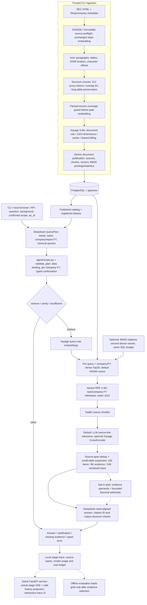

# Architecture and implementation map

The default query engine is a bounded LangGraph StateGraph (`agent/graph.py`) with request-local typed business state and dependency context. `serving/runtime.py` adapts the existing CLI/API contract. A planner is still one bounded model operation, not an autonomous subagent. PostgreSQL stores sources and retrieval indexes. Deep Agents, subagents and persistent checkpoints are not used.

For the exact node/edge definitions and how `runner.py`, `graph.py` and `nodes.py` connect to retrieval, see the [workflow code guide](repository-layout.md#langgraph节点边与模块怎么串起来).

The [next-runtime proposal](rag-agent-refactor.md) describes a typed-state, bounded LangGraph migration and its dependency/replay gates. The equivalent migration is implemented; evidence-driven follow-up remains planned.

## Runtime choices

| Component | Current default | Implementation |
| --- | --- | --- |
| Public input contract | `question`, required `as_of`, bounded `reading_context`, typed `confirmed_context` dictionary | `agent/planner.py: Request` |
| Planner | DeepSeek `deepseek-flash`, JSON schema with specific field/type repair feedback; ≤16 needs / 4 tasks / 2 queries per task; one repair | `agent/planner.py: plan_request` |
| Scope | Catalog aliases and confirmed metadata; explicit FY associations and exclusions per company | `agent/scope.py`, `agent/planner.py: validate_plan` |
| Retrieval | HNSW cosine, ef_search=100, iterative strict order, scan cap=20,000; Top20 per job; transaction-local JIT off | `retrieval/store.py: search` |
| SQL/resource bounds | ≤12 company/report-year groups per task; ≤192 actual search attempts including retries; SQL timeout 5s/attempt; one timeout recovery slot per request, no user-cancel retry | `configs/serving.json`, `retrieval/store.py` |
| Coarse fusion | RRF c=60 plus group/task interleave, ≤512 candidates, Top80 shortlist | `retrieval/search.py: rank_records` |
| Keyword alternative | PostgreSQL BM25 postings; one lexical job replaces the second dense job | `retrieval/lexical.py`, `retrieval/store.py` |
| Reranker | LLM 0–4 grades, need IDs and source-line bounds; batches ≤32 candidates | `retrieval/rerank.py` |
| Dedicated reranker | Optional `rerank-3-lite` query/document joint scoring; not embedding similarity | `providers/voyage.py: CrossEncoder` |
| Context | Original spans, overlap dedup and bounded table expansion; 8K/24K proxy-token caps | `retrieval/evidence.py`, `retrieval/context.py` |
| Answer | Supported/partial/missing per need; one structural repair with the preceding response and typed feedback; no automatic semantic acceptance | `answering/generation.py` |
| Arithmetic preparation | Opt-in (`calculation_tool=false` by default): one model call selects ≤32 source-anchored values/expressions; bounded Decimal execution, no arbitrary code. Literal/sign checks do not certify metric, period or unit selection | `answering/calculations.py`, `serving/runtime.py` |
| API | Localhost FastAPI, ≤2 in-flight requests, admission before worker dispatch | `serving/api.py` |
| Query UI | Static HTML/CSS/JS, actual stage SSE, read-only history; shared pipeline/budget | `serving/static/`, `serving/explorer.py` ([details](trace-explorer.md)) |
| Cost/trace | Persistent reservations; unknown billing stays reserved; no blind paid retry | `providers/llm.py`, `core/tracing.py` |

`cl100k_base` counts are a budget proxy, not the providers' billing tokenizer. Default retrieval is dense multi-query plus LLM reranking; retired rule-based hybrid controls have been removed from the source tree.

The 2026-11-07 reliability follow-up keeps planner, ANN parameters, fusion, reranker and context caps unchanged. The experimental generation profile emphasizes complete comparisons, late rounding, period-specific accounting-effect bridges and trend checks. Both that profile and arithmetic preparation require `calculation_tool=true`; the default generation prompt is unchanged. Structural repair and optional arithmetic remain within the shared paid-call ledger and 24K input cap. A second invalid structure remains a visible failure; a rejected arithmetic worksheet supplies no verified results. These checks do not establish answer truthfulness.

## Storage and provenance

`documents` holds immutable filing metadata; `blocks` holds parsed text/table structure and DOM/character locators; `chunks` holds source spans, embedding text, vectors and lexical fields. `publications` makes complete documents visible. `postings`, `term_stats` and index length statistics support BM25. Every selected evidence record carries document/accession context, date and source spans.

The current serving namespace is `finrag_live_ready`. The old `finrag` (five research chunk configurations) and `finrag_live` (bootstrap copy) schemas were removed on 2026-11-07. Compact historical results remain under `reports/public/`; retired vectors do not occupy a second database copy. The active schema retains one selected chunk configuration. Current ingestion publishes directly from HTML and metadata; it does not require bootstrap or the old research database.

Company aliases can be updated through the trusted metadata CLI without editing Python issuer lists. They are business entity metadata, not tenant authorization. This service has no public deployment or multi-tenant authorization claim.

## Correctness boundaries

- Report FY and a numeric table's fact FY are different. Explicit report constraints and confirmed scopes are guarded; arbitrary financial-period language still needs clarification and held-out evaluation.
- The FY guard recognizes explicit `FY2024`/ranges and bounded company associations. It is not a universal temporal parser. Unknown aliases should be clarified or registered rather than guessed.
- Long tables with four or fewer rows are retained even after preceding prose. Rows/headers can exceed the target chunk size; source coverage does not prove correct financial column interpretation.
- Citation existence, source offsets and answer shape are checked. Numeric accuracy, causal support and claim-level entailment are not automatically verified.
- A monotonic request deadline, native phase/SQL timeouts and cooperative cancellation are implemented. Already submitted synchronous calls drain; hard real-time interruption and representative load acceptance are not claimed.

The ANN filtering and iterative-scan approach follows [pgvector's documented behavior](https://github.com/pgvector/pgvector#filtering). Small filtered sets may favor exact search; no automatic router is currently enabled.

## LangGraph migration — 2026-11-08

`agent/runner.py` binds RunPolicy, then invokes the compiled graph. `agent/nodes.py` calls the existing algorithms; `reference.py` retains the sequential rollback control. Plans, ranking, evidence and answer inputs are compared with deterministic receipts; this is an orchestration check, not a new answer-quality score. Node transitions/tool receipts and additive typed outcomes are recorded alongside the original spans. No graph retry policy or checkpoint backend is enabled. Availability gating does not assert semantic sufficiency.

`configs/serving.json` keeps the same retrieval/context/model settings and adds `engine` and `run_policy`. Request-local counts and optional deadline/cost caps share the existing persistent ledger; unknown charges remain held. Deadline checks are cooperative, with existing HTTP/SQL timeouts for in-flight operations. [Detailed source and state map](repository-layout.md).

## Shared execution control — 2026-11-09

`serving/runtime.py` starts the request trace/control **before resource setup**, then `agent/runner.py` binds it throughout the graph. `agent/policy.py` owns request-wide node/model/provider/search/repair/recovery counts and monotonic time. `providers/llm.py` owns the sole persistent monetary ledger, including atomic answer headroom and optional resumed batch caps; there is no second balance.

Active policy: 180s/request, $0.15/request, $0.04 answer headroom, ≤16 nodes / 32 logical LLM calls / 64 actual provider requests / 192 search attempts. Planner/answer and each rerank batch get at most one schema repair; the whole request has one confirmed SQL-timeout recovery. Connect-only retry defaults to zero. The active cumulative shared stop is $4.90 of the user-authorized $5 total; $0.10 is retained for legacy embedding usage outside this ledger. Settled charges and unresolved reservations are preserved. This corrects the stale $1.60 default on 2026-11-12; per-request, retrieval/context/model parameters remain unchanged.

HTTP phase and search SQL timeouts are clamped to remaining time. Stream disconnect, explicit local cancellation and CLI Ctrl-C prevent subsequent actions; in-flight operations are not promised to stop instantly. Known late usage settles before delivery is suppressed; unknown charges remain held. Technical failures preserve typed outcomes and may expose **evidence-only** fallback without a generated answer. Scope insufficiency and dependency failures remain distinct. See [policy behavior and offline verification](rag-agent-refactor.md#6-orchestrator与执行策略).

## Live workflow observations — 2026-11-12

The browser reads graph-owned topology and separate node/stage events. New executions capture bounded allowlisted business state and operation-linked spans; old state omissions stay explicit. Managed local evaluation history enables baseline replay with no provider calls. This is additive observation/UI work: query planning, retrieval, reranking, generation and budgets are unchanged. [UI and module guide](trace-explorer.md).

## Analysis periods and information cutoff — 2026-11-12

`Request.as_of` limits filing availability (`filed_at <= as_of`); it does not choose the requested fact year. The browser defaults it to today under Advanced options. Explicit requested/confirmed periods survive planning; eligible later filings may support earlier facts when the user has not restricted report years.

`agent/planner.py` adds `Plan.temporal_scope`: analysis-period interpretation, scope source, exact user quote when applicable and a concise decision basis. New live responses require it; old records remain readable. Planner cache identity is `catalog-queryplan-v4-temporal-scope`. With no period and a reasonably answerable question, use each requested company's eligible catalog report years and disclose that metadata in the rendered answer. Reject omitted default coverage, fabricated scope quotes or a clarification scope routed to retrieval. Material calendar/fiscal or comparison-period ambiguity asks a concrete question and follows the existing early clarification exit. Semantic ambiguity judgments remain model-dependent and need subsequent authorized real-query evaluation.

`core/observations.py` and `serving/explorer.py` allowlist the annotation; `static/js/inspector.js` displays recorded scope plus its provenance. `answering/generation.py` prepends a deterministic metadata notice for catalog-default scope even when the model omits it. No Top-k, index, reranking strategy, answer model, budget or retry settings changed for this increment. Offline tests: `tests/test_temporal_scope.py`; spec: [temporal scope](../specs/015-temporal-scope/spec.md).
