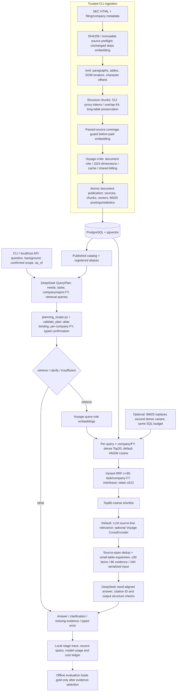

# Architecture and implementation map

The current implementation is a bounded Python RAG workflow. A planner is one model call with a JSON contract; it is not a separate autonomous agent. PostgreSQL stores both provenance and retrieval indexes. LangGraph, DeepAgents and subagents are not runtime dependencies.

## Runtime choices

| Component | Current default | Implementation |
| --- | --- | --- |
| Public input contract | `question`, required `as_of`, bounded `reading_context`, typed `confirmed_context` dictionary | `planning.py: Request` |
| Planner | DeepSeek `deepseek-flash`, JSON schema with specific field/type repair feedback; ≤16 needs / 4 tasks / 2 queries per task; one repair | `planning.py: plan_request` |
| Scope | Catalog aliases and confirmed metadata; explicit FY associations and exclusions per company | `planning_scope.py`, `planning.py: validate_plan` |
| Retrieval | HNSW cosine, ef_search=100, iterative strict order, scan cap=20,000; Top20 per job | `serving/store.py: search` |
| SQL/resource bounds | ≤12 company/report-year groups per task; ≤192 searches; SQL timeout 5s | `configs/serving.json` |
| Coarse fusion | RRF c=60 plus group/task interleave, ≤512 candidates, Top80 shortlist | `planned_retrieval.py: rank_records` |
| Keyword alternative | PostgreSQL BM25 postings; one lexical job replaces the second dense job | `serving/lexical.py`, `serving/store.py` |
| Reranker | LLM 0–4 grades, need IDs and source-line bounds; batches ≤32 candidates | `reranking.py` |
| Dedicated reranker | Optional `rerank-3-lite` query/document joint scoring; not embedding similarity | `serving/providers.py: CrossEncoder` |
| Context | Original spans, overlap dedup and bounded table expansion; 8K/24K proxy-token caps | `rerank_context.py`, `context.py` |
| Answer | Supported/partial/missing per need; structural validation only | `answering.py` |
| API | Localhost FastAPI, ≤2 in-flight requests, admission before worker dispatch | `serving/api.py` |
| Cost/trace | Persistent reservations; unknown billing stays reserved; no blind paid retry | `generation.py`, `tracing.py` |

`cl100k_base` counts are a budget proxy, not the providers' billing tokenizer. Default retrieval is dense multi-query plus LLM reranking; the historical `fr-rag query` command uses a different rule-based hybrid path.

## Storage and provenance

`documents` holds immutable filing metadata; `blocks` holds parsed text/table structure and DOM/character locators; `chunks` holds source spans, embedding text, vectors and lexical fields. `publications` makes complete documents visible. `postings`, `term_stats` and index length statistics support BM25. Every selected evidence record carries document/accession context, date and source spans.

The current serving namespace is `finrag_live_ready`. The frozen research namespace remains `finrag`; its five chunk configurations are historical controls, not five simultaneous serving searches. Legacy bootstrap data is not another actively updated knowledge base.

Company aliases can be updated through the trusted metadata CLI without editing Python issuer lists. They are business entity metadata, not tenant authorization. This service has no public deployment or multi-tenant authorization claim.

## Correctness boundaries

- Report FY and a numeric table's fact FY are different. Explicit report constraints and confirmed scopes are guarded; arbitrary financial-period language still needs clarification and held-out evaluation.
- The FY guard recognizes explicit `FY2024`/ranges and bounded company associations. It is not a universal temporal parser. Unknown aliases should be clarified or registered rather than guessed.
- Long tables with four or fewer rows are retained even after preceding prose. Rows/headers can exceed the target chunk size; source coverage does not prove correct financial column interpretation.
- Citation existence, source offsets and answer shape are checked. Numeric accuracy, causal support and claim-level entailment are not automatically verified.
- Per-call SQL/provider timeouts exist; a shared end-to-end deadline and representative load acceptance remain open work.

The ANN filtering and iterative-scan approach follows [pgvector's documented behavior](https://github.com/pgvector/pgvector#filtering). Small filtered sets may favor exact search; no automatic router is currently enabled.
