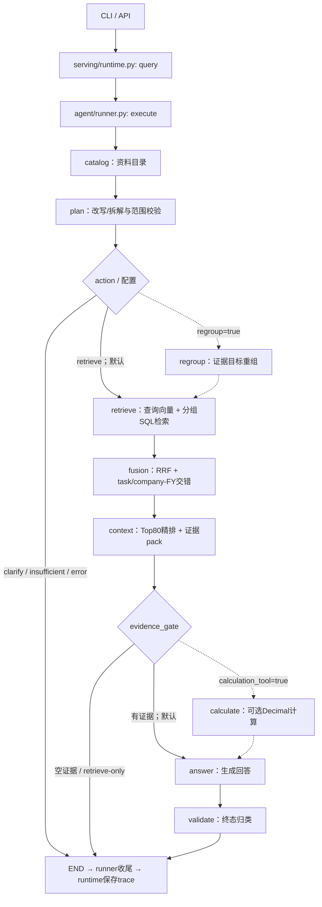

# 目录、模块和数据流

主入口只有一条：`serving → agent → retrieval / answering`。入库单独运行；离线评测不参与在线回答。README 展示总图，本页用于逐文件找代码。

## 文件职责

| 目录 | 文件 | 职责 |
| --- | --- | --- |
| `agent/` | `runner.py` | 建立一次请求、绑定 policy、调用图，转回原 API/trace 格式 |
| | `graph.py` | 编译 StateGraph；固定边、条件路由、节点记录及统一错误终止 |
| | `nodes.py` | 全部10个图节点的函数适配（含可选regroup/calculate） |
| | `state.py` | `RunState`、`RunContext`、工具回执与终态枚举 |
| | `policy.py` | 统一节点/模型/provider/SQL次数、修复和恢复次数、取消与剩余deadline；金额经唯一账本限制 |
| | `planner.py` | Request / QueryPlan 契约、catalog、prompt、缓存、一次修复及计划校验 |
| | `scope.py` | 从原问与确认中提取财年/排除条件，不按固定公司词表工作 |
| | `regroup.py` | 可选证据目标重组，默认关闭 |
| | `reference.py` | 迁移期顺序流程对照；默认CLI/API不执行，不是自动故障回退 |
| `ingestion/` | `acquire.py` | SEC pinned manifest 下载及校验 |
| | `parse.py` | HTML → 文字/表格 block、DOM locator、规范字符区间 |
| | `chunk.py` | block → chunk、source spans、token proxy、稳定配置 ID |
| | `publish.py` | 原文身份/覆盖率预检、缓存 embedding、调用原子发布 |
| | `generalization.py` | 新公司 manifest 的 download / prepare / publish |
| `retrieval/` | `store.py` | PostgreSQL 表、catalog、原子发布、ANN/词法 SQL、过滤与受限超时恢复 |
| | `search.py` | QueryPlan → 搜索任务，query embedding、分组搜索、RRF 候选合并 |
| | `fusion.py` | 通用任务/分组交错；实际 RRF 实现在 `search.py:rank_records` |
| | `selection.py` | Top80 后选择 reranker，并串起 rerank 与 context 两个 trace 阶段 |
| | `rerank.py` | LLM 批次评分、来源行号、缓存与校验 |
| | `evidence.py` | 精排输入整理、原文去重/展开及最终证据选择 |
| | `context.py` | EvidenceStore、span 合并、表格/来源文本构建 |
| | `need_context.py` | 可选按 need 分配上下文的策略，默认配置未启用 |
| | `lexical.py` | BM25 postings/statistics 和同预算替换查询 |
| `answering/` | `generation.py` | 原问＋计划＋证据 → 回答；格式、need、引用 ID 校验及一次结构修复 |
| | `calculations.py` | 可选来源锚点＋有界 Decimal 表达式；默认关闭，尚非财务口径验证工具 |
| `providers/` | `llm.py` | DeepSeek、PaidClient、持久预留/结算账本、query embedding 基类 |
| | `embedding.py` | Voyage 缓存、批次与向量校验基础实现 |
| | `voyage.py` | 共用账本的 document/query embedding 和可选专用 CrossEncoder |
| | `traced.py` | 模型调用 span、请求级调用次数检查 |
| `core/` | `models.py` | Filing、Block、Chunk、Hit 及离线证据标签模型 |
| | `config.py` | 项目根目录与本地设置；密钥只从忽略的配置/环境读取 |
| | `files.py` | JSON/JSONL、hash、原子写文件 |
| | `tracing.py` | span、嵌套关系、时间与实际源码身份 |
| | `deadlines.py` | 旧串行实验信号超时工具；当前CLI/API/评测均使用RunControl，未接入此适配 |
| `serving/` | `cli.py` / `api.py` | 可信本地命令与 HTTP/SSE 入口、并发准入 |
| | `runtime.py` | 在资源初始化前建立trace/control，调用agent、清理资源、记录图外失败与总耗时 |
| | `resources.py` / `config.py` | 创建每次请求的依赖、读取默认配置与共享账本 |
| | `errors.py` | 存储/provider 可公开的错误代码类型 |
| | `explorer.py` / `code_view.py` | 安全 trace 投影、固定代码白名单和当前行号 |
| | `history.py` | 可信run/case目录、成员校验、有界只读历史回放 |
| | `static/js/` / `static/css/` | 按transport/state/workflow/inspector/results拆分，无需npm构建；详见[UI文件职责](trace-explorer.md) |
| `evaluation/` | `__main__.py` | 一个入口：check-data / build-intents / run / prepare-judge / export-judge / score |
| | `run.py` | 只接收query-only数据，通过serving.query运行；支持同账本批次限额与身份绑定续跑，可能收费 |
| | `answers.py` | 保存回答的事实/数字/引用逐项评分及审核材料 |
| | `rubric.py` | 五维 Judge prompt 和导入判定的评分；不自动调用模型 |
| | `evidence.py` | 精确来源 span 的证据组 recall，无旧实验依赖 |
| | `dataset.py` | 采纳后小集的schema、哈希、来源区间和family校验，不调用DB/API |
| | `benchmark.py` | 保存Trace的阶段覆盖/范围检查、导入行为判定、复用答案评分与成对报告，不自动Judge |
| 包根 | `cli.py` / `models.py` | 两个薄兼容入口，分别供已安装 CLI 和冻结数据构建器使用 |

## LangGraph：节点、边与模块怎么串起来

核对日期：2026-11-12。**不是都写在`runner.py`里**。运行入口、图结构、节点适配和算法分四层；`agent/`中的文件不是多个Agent。

| 层次 / 文件 | 负责什么 | 不负责什么 |
|---|---|---|
| `serving/runtime.py:query` | 在资源初始化前创建trace/control，打开DB/provider依赖，调用runner、清理并保存trace | 不定义业务节点顺序 |
| `agent/runner.py:execute` | 组装RunContext，绑定共享控制，调用`build_graph().invoke(...)`，统一返回/失败/证据兜底 | 不逐段手写检索或精排算法，也不定义图的边 |
| `agent/graph.py:build_graph` | 注册10个节点、定义边和条件路由；`wrap`记录节点执行并统一处理异常 | 不承载SQL、打分或生成prompt |
| `agent/nodes.py` | 每个node的输入输出适配，调用已有planner/retrieval/answering模块，写业务状态与trace | 不另建一套检索算法 |
| `agent/state.py` | `RunState`业务数据；`RunContext`活依赖；`Outcome`终态 | 不保存跨请求长期记忆 |
| `agent/policy.py` | 全请求节点/模型/provider/SQL次数、deadline、取消和金额预留协作 | 不定义下一节点；唯一持久金额账本仍由`providers/llm.py`管理 |

当前是**有planner的有界workflow**：图结构由代码预先定义，LLM决定取证需求、查询文本和限定范围。不是让LLM每轮任意选择工具的ReAct，也不是多Agent；`Plan.tasks`是检索任务参数，不会动态生成新的LangGraph节点。

### 默认实际路径



图中省略了各阶段失败后的`END`边，下表列全；虚线是默认关闭的业务路径。真实编译图导出见[agent-workflow.mmd](agent-workflow.mmd)。

### 全部10个注册节点

| 节点 | 输入 → 写入RunState | 实际实现 / 与其他模块的调用 |
|---|---|---|
| `catalog` | Request.as_of → `catalog_fingerprint`；目录对象在RunContext | `nodes.catalog → LiveStore.catalog`，读取已发布filing与别名，生成截止日目录快照 |
| `plan` | 原问＋catalog → `original_plan`、`plan`；必要时终态 | `nodes.plan → planner.plan_request → validate_plan / scope.py`；DeepSeek生成needs/tasks/queries并校验 |
| `regroup`（默认关） | plan → 重组后的`plan` | `nodes.regroup_plan → agent/regroup.py:regroup`；保留需求/公司/期间，限制SQL预算，不是再补查一轮 |
| `retrieve` | plan → `records`（每job的query、公司/财年、hits） | `nodes.retrieve → PlannedRetriever.search → prepare_searches → Voyage query embedding → LiveStore.search`；真实HNSW/可选lexical SQL |
| `fusion` | records → `ranked`（≤512候选） | `nodes.fuse → retrieval/search.py:rank_records`；RRF及group/task交错去重；默认只融多路dense结果，不等于hybrid |
| `context` | ranked＋plan → `selected`、`evidence`、`context_metadata` | `nodes.context → selection.select_context`：取Top80→`rerank.grade_candidates`→`evidence.select_reranked`；一次node内完成精排、表格/原文组装和预算裁剪 |
| `evidence_gate` | evidence → `evidence_status`、`outcome` | `nodes.evidence_gate`只判断有无证据；`available_unverified`不表示足以正确回答 |
| `calculate`（默认关） | 实际来源/操作数 → `calculation_results` | `nodes.calculate → answering/calculations.py:prepare_calculations`，模型取操作数、受限Decimal执行；不是任意Python |
| `answer` | 原问＋plan＋evidence（可选计算）→ `generation` | `nodes.answer → answering/generation.py:generate_answer`；包含既有结构/引用ID检查及有限格式修复 |
| `validate` | structured_answer.sections → `outcome` | `nodes.validate`：所有section为supported则answered，否则partial_answer；**没有独立语义Judge或财务正确性验证** |

默认完整问题走8个节点；10是包含两条可选路径的注册数量，16是单请求允许的节点执行上限。node不是一次API调用：`retrieve`内有embedding和多次SQL，`context`内有多个rerank批次，schema修复也可能增加模型调用。

### 全部边与分支条件

| 来源 | 正常下一步 | 提前结束 / 其他条件 |
|---|---|---|
| `START` | `catalog` | — |
| `catalog` | `plan` | error → END |
| `plan` | `retrieve` | error或action不是retrieve → END；否则regroup=true → regroup |
| `regroup` | `retrieve` | error → END |
| `retrieve` | `fusion` | error → END |
| `fusion` | `context` | error → END |
| `context` | `evidence_gate` | error → END |
| `evidence_gate` | `answer` | error、无证据或do_generate=false → END；其余calculation_tool=true → calculate |
| `calculate` | `answer` | error → END |
| `answer` | `validate` | error → END |
| `validate` | `END` | 最终清理由runner/runtime完成 |

路由函数是`graph.py:after_plan`和`after_gate`；其他错误分支在`build_graph`内定义。图没有回到retrieve的环，没有自动上网补查，也没有LangGraph重试策略。有限schema修复/SQL超时恢复在具体工具内部且受policy计数，不是图循环。澄清目前终止本次请求，不是持久暂停；调用方补充`confirmed_context`后发起新请求。

### 跟着一次请求读代码

```text
serving.cli / serving.api
  → serving.runtime.query                   接入、资源、保存trace
  → agent.runner.execute                    绑定RunContext/RunControl
  → agent.graph.build_graph().invoke(...)    依据边推进
  → agent.nodes.<node>                      适配业务状态
       plan    → agent.planner / scope
       retrieve→ retrieval.search → providers.voyage / retrieval.store
       fusion  → retrieval.search.rank_records
       context → retrieval.selection → retrieval.rerank / evidence / context
       answer  → answering.generation → providers.llm
  → runner.finish / release_unused → runtime返回
```

`RunState`传递request、plan、records、ranked、evidence、generation和outcome；连接、模型客户端、catalog缓存及control放在`RunContext`。节点还把完整I/O写入原trace，因此看数据流时同时看state与trace，不能只看节点数量摘要。没有checkpointer、跨请求记忆或并行fan-out。`reference.py`是迁移时顺序执行对照，默认CLI/API不会使用；不是第二个Agent。

想改**顺序/分支**看graph；改**检索/精排算法**看retrieval；改**规划/生成prompt**看planner/generation；改**预算/取消**看policy及provider账本。仅查看代码不需要触发付费请求。

## 入库如何连接查询

`acquire → parse → chunk → publish.ingest_html → Voyage embedding → LiveStore.publish`。发布事务同时写入 documents、blocks、chunks、publications、postings、term_stats 和 index statistics。查询从 catalog / chunks / blocks 读取，不在每个问题中重新解析 HTML。新财报继续用 `scripts/ingest_manifest.py` 或 CLI `ingest`。

只保留 `finrag_live_ready`：16 份财报、4,961 个 chunk、一个切块配置。前一轮删除两套旧 schema 释放约 593 MiB，历史报告压缩净减约 1 GiB；[清理回执](../reports/public/cleanup.json)为历史记录。本轮没有重新入库或改写向量。

## 状态、预算和环境

- `RunState` 是单次运行的业务状态；live client / 连接不进入状态，放在请求独立的 `RunContext`。
- 图默认最多 16 次节点执行、32 次模型调用；原有 ≤192 SQL 尝试、Top80、8K / 24K 和累计计费停止线不变。金额预留与结算仍只有原 ledger 一套，新增 run/operation 归属。
- 当前默认deadline为180s，单请求上限$0.15，其中$0.04为答案headroom；在节点和外部调用前后检查。deadline为协作式，HTTP阶段/SQL timeout受剩余时间约束，不承诺立即强行中断所有在途操作。
- 没有自动付费重试、证据补查循环、持久 checkpoint 或跨请求记忆。`available_unverified` 表示有证据，不表示语义已经验证。
- 本机运行环境为 `.venv-migrate`，原 `.venv` 未替换。`requirements.lock` 为运行/开发依赖；`requirements-evaluation.lock` 包含完整评测依赖。官方 PyPI 的 LangGraph 1.2.20 与已验证的 RAGAS/community 组合已锁定。

[真实 StateGraph 导出](agent-workflow.mmd) · [迁移状态和下一步](rag-agent-refactor.md) · [源文件迁移记录](module-moves.json)。

图执行显式关闭 LangSmith 自动上报，继续使用本地 trace；没有新接入云端观测账户。

## 当前保留的脚本

`README.zh-CN.md` 的“scripts 里每个文件是什么”列出全部六个脚本、输入输出、命令和费用。它们是两个仍在用的数据配方、manifest 入库、只读 SQL 检查、暂存区安全扫描和公开结果校验。旧实验驱动、synthetic benchmark、vendor 树检索、prompts 和整个 archive 已删除；当前运行和测试不依赖它们。

2026-11-12：Workflow Explorer直接使用实际图定义；每个新node记录白名单State前后变化，node与stage事件分别投影。旧trace仅展示当时记录，不重建历史。目录整理保留现有Python业务分层，删除被模块化前端替换的旧app.js/style.css，无新增archive。
